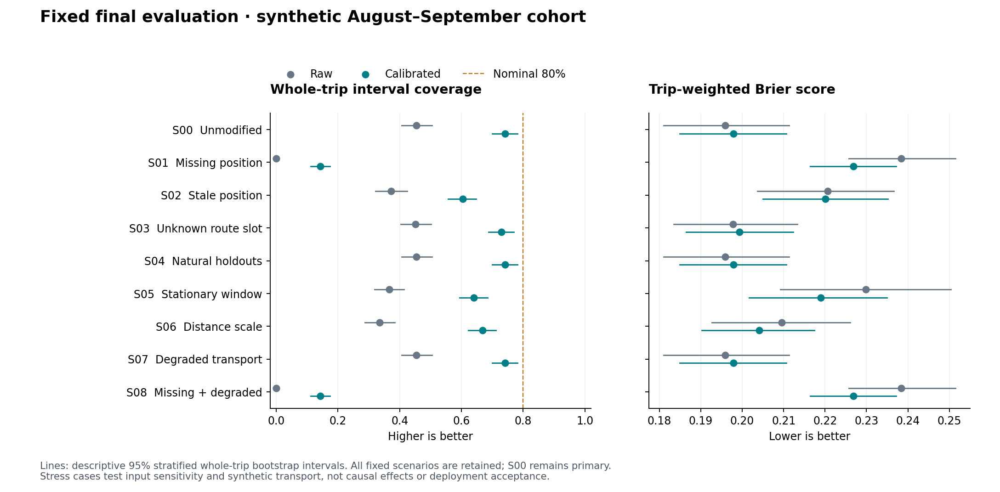
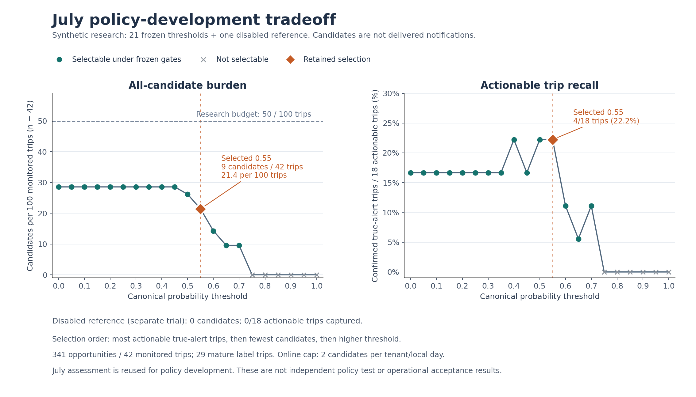
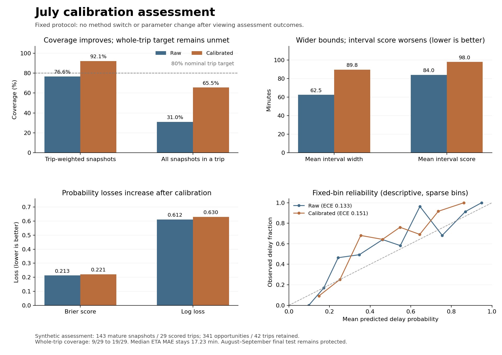
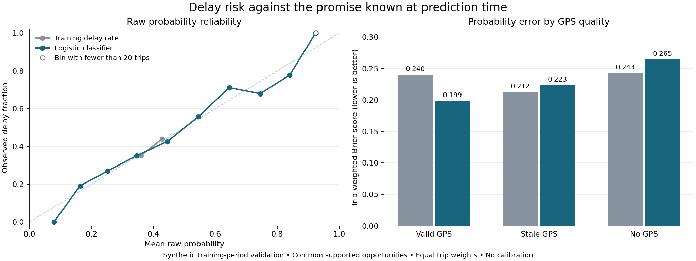
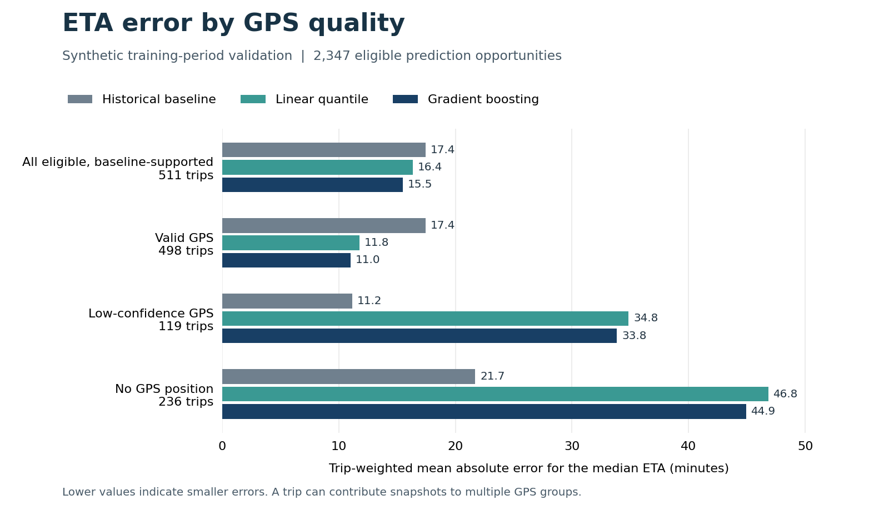

# DS-M01 — ETA intervals and delay alerts

A reproducible data foundation for estimating fleet arrival times and identifying delay risk. **Engineering and Method Demonstration — Synthetic Data.** The pipeline reconstructs what dispatch could know at each prediction time, separates gate arrival from service and delivery completion, and preserves source lineage for every derived record.

**Current stage: synthetic adoption, actions, follow-up and trip inspection (P09 / M4.2–M4.3).** The workflow extends the fixed P08 primary scenario through recipient review and operator response, with a read-only viewer for all 400 trips. It retains the original forecasts, final outcomes and quality limitations. Synthetic response behavior does not establish human adoption, faster arrivals or deployment readiness.

All operational observations are original synthetic data for January–September 2026. They are not Rollingtrans customer telemetry or real fleet operating records. Scenario frequencies are engineering fixtures, not estimates of real-world prevalence.

## What does the workflow demonstration add?

The fixed P08 primary scenario supplies 3,200 opportunities, 63 alerts and 59
transport attempts across 400 trips. Its 42 confirmed successful deliveries are
the starting population for synthetic review. Service delivery, recipient opening,
adoption, operator action and observed follow-up remain separate events. Failed
delivery does not count as rejection, and a successful retry cannot create a second
adoption decision for the same alert.

| Primary-S00 synthetic workflow measure | Result |
| --- | ---: |
| Confirmed deliveries / opened / reviewed alerts | 42 / 40 / 33 |
| Accepted / partially accepted / overridden / rejected / not reviewed | 18 / 7 / 6 / 2 / 9 |
| Accepted or partial, among all delivered alerts | 25/42 (59.5%) |
| Accepted or partial, among reviewed alerts | 25/33 (75.8%) |
| Executed actions / explicit no-action records | 31 / 2 |
| Canonical follow-up records / comparable mature arrivals | 31 / 1 |

The 31 executed actions include six driver contacts, five customer contacts,
16 reassignments and four reschedules. Only one has a mature confirmed arrival
comparison. The other 30 retain 21 not-reported, five lost, three disputed and one
rejected follow-up observation. Seventeen not-reported cases have only a pending
source version known within the follow-up window; verified revisions arrive roughly
20 days later. Those later labels are not used early. The scenario does not establish
an operational adoption rate or intervention benefit.

The separate P09 store adds adoption, action and follow-up records. Opening remains
an auxiliary synthetic observation; inherited P08 notification rows are unchanged.
Follow-up keeps the original alert promise and any revised promise separately,
using the same retained arrival. A deadline extension can change the measured delay
without improving arrival time. Unknown or immature outcomes retain their own
states and are excluded from known-arrival comparisons.

Download or open [the trip viewer](workflows/p09/evidence/viewer.html) locally to
filter tenants and trips and inspect event clocks, model versions, promises,
transport attempts and follow-up. The HTML contains its data and requires no
server. It is read-only; retrospective outcomes are labeled separately from what
dispatch could know at prediction time.

See the [workflow specification and commands](docs/p09_workflow.md), [saved results
and denominators](workflows/p09/evidence/README.md), and [independent
audit](workflows/p09/evidence/independent_checks.json). This is post-evaluation
workflow development, with no model refit, new untouched final test, real message
delivery or causal benefit estimate.

Preparation passed 727 original tests, 17 portability tests and 115 P09 tests.
The independent workflow audit passed 26,524 comparisons. The viewer's nine unit
tests are included in the P09 suite; 18 additional offline JavaScript interaction
checks passed. Actual browser rendering and visual review remain pending.

## What did the fixed final evaluation show?

Primary S00 whole-trip interval coverage is 243/328 (74.1%), below the nominal 80%; the
92.0% weighted snapshot coverage is a different measure. Calibration widens the mean
interval from 62.85 to 95.69 minutes and increases interval score from 96.05 to 115.04
minutes (lower is better). Probability-loss point estimates also increase slightly, but
their paired descriptive 95% ranges cross zero; statistical inferiority is not
established.

The unseen route, ROUTE-12, has zero covered trips out of 33 eligible trips. Removing
all position inputs in S01 lowers whole-trip coverage to 47/328 (14.3%). Available
forecasts do not establish successful generalization. All nine scenarios are retained as
fixed synthetic comparisons, with S00 primary; none estimates real fleet benefit.

| Primary S00 measure | Result |
| --- | --- |
| Original test trips / opportunities | 400 / 3,200 |
| All-eligible-trip interval coverage | 243/328 (74.1%) |
| Raw / calibrated probability Brier score | 0.1959 / 0.1978 |
| Candidate alerts / confirmed synthetic deliveries | 63 / 42 |
| Useful delivered trips / actionable positive trips | 26/137 (19.0%) |
| Useful / known-assessable first successful deliveries | 26/38 (68.4%) |
| Unresolved / all first successful deliveries | 4 / 42 |

The models, calibrators and 0.55 policy remain unchanged. G14/G15/G16 stay open, and
quality/operational approval remains false. The later P09 workflow uses this fixed
primary result without changing its evaluation.



Read the [findings and limitations](docs/p08_final_evaluation.md), [complete results and
denominators](reports/p08/README.md), and [independent
audit](reports/p08/independent_checks.json).

## What did the synthetic delivery experiment show?

The existing 0.55 rule, models and calibrators were retained. A fixed transport
scenario adds service latency, receipt lag, at most three attempts and retries
only after confirmed transient failure. Dispatch and service both check the
original promise, minimum notice, episode state, lifetime and delivery cooldown.
The scenario probabilities are hypothetical; no messaging service was contacted.

| July delivery-development measure | Result |
|---|---:|
| Candidate alerts / monitored trips | 9 / 42 |
| Transport attempts, including one retry | 8 |
| Confirmed synthetic deliveries / delivered trips | 7 / 7 |
| Useful delivered alerts / actionable delayed trips | 4 / 18 (22.2%) |
| Conditional useful-first-delivery precision | 4 / 6 (66.7%) |
| Unresolved first-delivery targets | 1 of 7 |
| Successful deliveries per 100 monitored trips | 16.67 |

Two candidate alerts were suppressed by the delivery cooldown. One transient
failure was followed by a successful retry. All seven confirmed deliveries
were to different trips, so there were no delivered repeats. The unresolved
first delivery has an unknown target, not an unknown transport status.

A useful alert must be delivered before the trip's actual arrival and at least
30 minutes before its original promise deadline. Precision conditions on six
known-assessable first successful deliveries; across all seven, usefulness is
bounded by 4/7 to 5/7. These are identification bounds, not confidence intervals.
The first successful delivery supplies its own promise and service clock;
failed attempts are not counted as duplicate disturbances.

These figures reuse the July policy-development cohort and are subject to its
selection optimism. They do not establish independent policy performance,
recipient opening, adoption or fleet benefit. The copied P06 output-release
records retain actual November execution times; the new July alert and transport
clocks are explicitly synthetic scenario times.

See the [delivery protocol](docs/p07_delivery.md),
[results and reproduction](reports/p07/README.md), and
[typed-store checks](reports/p07/store/verification.json).
The [final-evaluation protocol](docs/p08_evaluation_protocol.md) freezes
August–September cohorts, metrics, uncertainty and stress cases. P08 subsequently completed the fixed final evaluation and its pre-target implementation gate; see the final results above. The historical P07 specification remains unchanged.

The [P07 engineering verification](reports/p07/verification.json) records 576
passing unit tests, zero differences in retained and source-assisted replay,
and 9,226 independent reference comparisons with no failures. Reproduction and
its clock-normalization limits are documented with the saved results.

## What did the alert-policy experiment show?

The rule uses a 30-minute minimum prospective notice, 30-minute repeat
suppression and a cap of two candidates per tenant per local day. These limits
and the budget of 50 candidates per 100 monitored trips are hypothetical research
settings, fixed before the sweep after P05's July assessment results were known.

| July policy-development measure | Result |
|---|---:|
| Probability threshold | 0.55 |
| Admitted candidates / monitored trips | 9 / 42 |
| Confirmed actionable delayed trips captured | 4 / 18 (22.2%) |
| Conditional first-candidate precision | 4 / 6 (66.7%) |
| Unresolved first candidates | 1 of 7 |
| Candidate burden per 100 monitored trips | 21.43 |

The precision fraction covers only first candidates with eligible targets.
Across all seven first candidates, usefulness is bounded by 4/7 to 5/7;
these are identification bounds, not confidence intervals. Unknown outcomes
and two repeat candidates still count toward burden. No notification was sent.

All 21 thresholds and the disabled reference are retained. Selection reuses
the P05 assessment cohort, so these figures are subject to selection optimism
and cannot serve as independent final-policy performance. At the P06 stage, August–September outcomes remained outside fitting, selection and scoring. P08 now reports their fixed evaluation above.

See the [policy protocol](docs/p06_alert_policy.md),
[results, denominators and reproduction](reports/p06/README.md), and
[typed-store checks](reports/p06/store/verification.json).



The [engineering verification](reports/p06/verification.json) records 489
passing unit tests, zero differences in retained and source-assisted replay,
and 163,968 independent reference comparisons with no failures. These checks
establish reproducible implementation behavior; they do not approve model or
policy quality.

## Did July calibration improve the forecasts?

The selected ETA model and independent delay classifier were refitted on the
original training cohort, using only information available before July 1.
Calibration used July 1–10 departures with labels known before July 15. July
11–14 formed a buffer; July 15–24 supplied assessment trips with labels known
before August 1. All cutoffs use Los Angeles time and keep trips intact.

Assessment retained 341 opportunities from 42 trips. Both targets were scorable
at 143 snapshots from 29 trips; 198 excluded-label opportunities remained visible.
The table compares raw and calibrated outputs on that same eligible cohort.

| July assessment metric | Raw pipeline | Calibrated pipeline |
|---|---:|---:|
| Trips with every eligible snapshot covered | 9/29 (31.0%) | 19/29 (65.5%) |
| Trip-weighted snapshot coverage | 76.6% | 92.1% |
| Mean interval width | 62.53 min | 89.75 min |
| Brier score, lower is better | 0.2129 | 0.2208 |
| Log loss, lower is better | 0.6120 | 0.6303 |

The higher snapshot coverage does not establish the 80% whole-trip target.
Intervals widened, and their mean interval score also worsened. The raw median
was unchanged. Probability loss and fixed-bin reliability error increased, so
calibration is not presented as a quality improvement. The methods were not
retuned or switched after these results.

All three tenants had enough support to fit both calibrators in this run.
If a calibrator lacks support, the implementation preserves the raw output and
marks it unsupported/uncalibrated. No assessment fallback occurred here.
See the [fixed protocol](docs/m3d_calibration.md),
[results, denominators and reproduction](reports/m3d/README.md), and
[independent checks](reports/m3d/independent_checks.json).



This July assessment cohort is reused for P06 policy development. It
cannot also serve as an independent final-policy test. At the P05 stage, August–September outcomes had not been used for fitting, selection or scoring. P08 now evaluates the frozen pipeline without retuning.

## Training-period delay validation (P04)

The following results belong to the earlier chronological training folds. Their
models and cohort differ from the July refit and assessment above.

Both methods preserve all 5,163 validation opportunities. Scoring uses 2,358
snapshots with mature, independently verified gate-arrival outcomes. Later
reschedules leave earlier snapshot deadlines unchanged. Cancelled, incomplete,
pending and already-arrived cases retain explicit unscored states.

| Raw probability metric, equal weight per trip | Training delay rate | Logistic classifier |
|---|---:|---:|
| Brier score, lower is better | 0.2393 | 0.2061 |
| Log loss, lower is better | 0.6714 | 0.5988 |
| Average precision | 0.4153 | 0.6274 |
| ROC AUC | 0.5327 | 0.7178 |

The gain is not uniform. Stale GPS, missing GPS and the 0–30-minute advance
stratum have higher probability error than the baseline. Snapshots after the
deadline are reported separately because their lateness is already observable.
These checks do not choose a warning threshold or establish calibrated risk.



See the [delay protocol](docs/m3c_delay.md), [results and reproduction](reports/m3c/README.md)
and [independent checks](reports/m3c/independent_checks.json).

## Training-period ETA selection (P03)

The same 2,347 baseline-supported prediction opportunities were scored for all
three methods. Each trip had equal weight. Linear quantile regression reached
16.36 minutes of median-ETA error and produced the narrowest raw interval.
Gradient boosting reached 15.48 minutes and met the decision rule fixed before
scoring. Across all 5,163 opportunities it delivered its own forecast 5,162
times and the historical fallback once.

On snapshots with low-confidence GPS, boosting's error rose to 33.84 minutes,
compared with 11.15 minutes for the baseline. These subgroups will need separate
checks during calibration. July was reserved when this selection was made;
its later calibration assessment is reported above. August–September was reserved for the later fixed P08 evaluation reported above.



[Comparison protocol, cohort definitions and full results](docs/m3b3_comparison.md)

## Check a saved forecast run

From the repository root, create an environment and replay the saved P08 final evaluation. Python 3.12 was used for the recorded run. This uses retained final evidence and saved model/calibrator states; it needs no Docker, raw outcome file or M2 rebuild.

```bash
python3 -m venv .venv
source .venv/bin/activate
python -m pip install -r requirements-models.lock
python -m pip install -e . --no-deps
python reproducibility/p08/portable_replay.py --root . --report reports/p08
```

This separately versioned verifier checks all nine scenarios, each retaining 400 trips
and 3,200 opportunities. Rebuilt forecasts, decisions and scores must satisfy the
original numerical tolerance; the saved JSONL, DuckDB and Parquet store must match an
exact reconstruction from its retained inputs. It does not fit models, select thresholds
or send notifications. See the [post-exposure verification revision](docs/p08_portable_verification.md)
for the distinction between numerical replay and stored-artifact integrity.

The original `python -m ds_m01.final_replay --root . --report reports/p08` entry point
remains unchanged. It can reject native macOS floating-point differences that pass its
earlier tolerance checks, because it also hashes freshly reconstructed raw floats.
The portability verifier does not claim that this original strict command passed.
Both commands reproduce already-exposed evidence; neither is another untouched test.
Run the original suite with `python -m unittest discover -s tests -v` and the supplemental
verifier tests with `python -m unittest discover -s reproducibility/p08/tests -v`.
The earlier P07 delivery replay remains available as
`python -m ds_m01.delivery_replay --root . --report reports/p07`.

For exact retraining, follow the [fixed-container guide](docs/reproducibility.md).
For the full data build, [see the commands and disk requirements below](#run-locally).

## Quantile candidate training and inference

Linear and gradient-boosted quantile regressors use fixed defaults and the same
twelve tenant/fold transformers. The 18,343 fit opportunities yield 8,417 eligible
positive remaining-duration targets across 1,869 trip/fold memberships. Expanding
folds reuse trips; these counts do not represent independent observations.

Each family preserves all 5,163 validation opportunities without reading their
outcomes. The resulting 24 model states contain 72 quantile estimators.

| Prediction source, synthetic validation opportunities | Linear quantile | Gradient boosting quantile |
|---|---:|---:|
| Candidate prediction | 4,669 | 5,162 |
| Historical-baseline fallback | 24 | 1 |
| Explicitly unavailable | 470 | 0 |

These are inference availability counts, **not accuracy results or a model
ranking**. Nonpositive raw estimates trigger fallback; crossed positive quantiles
are sorted and flagged. Raw values and all decisions remain in the artifacts.
These retained fold intervals are raw. P05 separately refits the selected model and calibrates its July forecasts. The training-period comparison uses one fractional-second target and reports separate availability and error denominators for all three methods.

See the [candidate protocol](docs/m3b2_candidates.md),
[retained evidence](reports/m3b2/README.md), historical
[verification](reports/m3b2/verification.json) and
[reproducibility guide](docs/reproducibility.md).

Native macOS retraining failed the original replay check. On Mac Docker Desktop,
two fresh Linux/amd64 containers ran the integrated training command at commit
`0814fa1`. Both reproduced the same four files byte-for-byte: models,
predictions, training rows and summary. The [verification summary](reports/m3b2_integrated_replay_20261031.json)
identifies that commit, the image, the output hashes and the 285 local tests.
These runs did not use July calibration or August–September test labels to
evaluate the candidates.

## Feature preparation

The feature-only runner prepares 7,850 original-training snapshots, builds 12
tenant/fold transformers, and retains all 5,163 chronological validation
opportunities. Stale speed and remaining-distance signals are masked; missing
indicators and unknown-category slots preserve observation limitations. These
counts describe feature preparation, not model accuracy. No target file is
opened, and calibration/final-test groups never enter feature fitting.

The [feature protocol](docs/m3b1_features.md#reproduce) gives the historical
checkout for replaying the five recorded artifacts and the current command for
processing fractional source clocks. See the [feature contract](contracts/m3b1_features.json)
and [retained verification](reports/m3b1/verification.json).

## Historical ETA baseline

The retained M3a experiment predicts remaining gate-arrival time from strictly
prior, tenant-local durations. Route/departure groups fall back to distance bands
or tenant history; insufficient surviving support produces an unavailable result.

| Training-period validation result | Value |
|---|---:|
| Prediction opportunities / trips | 5,163 / 654 |
| Available predictions over all opportunities | 3,357 / 5,163 (65.02%) |
| Eligible, supported snapshots / scored trips | 2,347 / 511 |
| Trip-balanced median-ETA MAE | 17.43 minutes |
| Trip-bootstrap MAE interval (95%, synthetic sample) | 15.96–19.00 minutes |
| Raw P10–P90 coverage / mean width | 77.84% / 67.53 minutes |

The error denominator excludes unsupported and unavailable outcomes, while the
availability denominator retains all opportunities. These synthetic,
training-period results do not measure final-test or operational performance.
The P10/P90 interval has not been calibrated. See the [protocol](docs/m3a_baseline.md)
and [results, denominators and limitations](reports/m3a/README.md).

## Data and engineering results

| Item | M2 result |
|---|---:|
| Trips | 1,800 (200 per month) |
| GPS events | 197,303 |
| Snapshots and corresponding labels | 14,349 each |
| Historical training-trip references | 2,536,045 |
| Provenance records | 2,775,752 |
| Canonical schemas and typed Parquet exports | 28 each |
| Populated data-stage tables | 17 |
| Reserved, empty model and alert tables | 11 |

The pipeline evaluates event time and availability time separately. It selects only promises, positions, device assignments and status versions known at the snapshot. Gate observations supply arrival labels independently of GPS. Historical references are limited to eligible training trips with mature observations available at that time.

Of 14,349 snapshots, 6,966 have eligible labels, 4,272 are not mature, 164 are cancelled and 2,947 were already at the destination before arrival status became known. The eligible total includes 1,122 snapshots assigned to excluded trips; those are not model input. Position quality is valid for 6,394 snapshots, stale (`low_confidence`) for 7,096 and unavailable for 859.

| Split | Trips | Eligible trips | Eligible snapshots |
|---|---:|---:|---:|
| Train | 992 | 805 | 3,670 |
| Calibration | 171 | 130 | 596 |
| Test | 400 | 328 | 1,578 |
| Excluded | 237 | 195 | 1,122 |

See the [data validation guide](docs/data_validation.md) for figures and interpretation, and [generator assumptions](docs/generator_assumptions.md) for route geometry, observation delays and scenario design.

## Validation evidence

The retained M2 execution receipts record:

- **49 unit tests, 27 warehouse checks and 22 readiness checks passed.** Readiness is `ready_for_m3_with_cautions`, not a model or deployment approval.
- **M1 continuity:** the 120-trip M1 business rows and all 937 snapshot/label rows remain exact subsets. Under the original M1 configuration, the optimized pipeline reproduces all seven M1 processed JSONL files byte-for-byte.
- **HTTP transport:** 1,441 pages received, one injected 503 retried and 137 duplicate records replayed, with no added canonical rows. All 197,303 received GPS records match the canonical source.
- **Fresh rebuild:** SHA256 equality for 48 source, processed and Parquet files, plus equality for seven HTTP-derived outputs.

The evidence is in [unit test results](reports/unittest_results.txt), [warehouse checks](reports/quality_report.json), [M2 readiness](reports/m2_readiness.json), [M1 pipeline compatibility](reports/pipeline_m1_compatibility.json), [HTTP results](reports/last_http-check.json) and [rebuild results](reports/rebuild_report.json). Historical M1 receipts are retained separately in [reports/m1_reference/](reports/m1_reference/).

These are historical M1/M2 execution results. The documentation and reporting cleanup did not rerun the full M2 dataset; its current checks are recorded separately in [public cleanup validation](reports/public_cleanup_validation.json).

M3a's fresh M2 replay, extended tests, input-hash checks and deterministic baseline
replay are recorded separately in [M3a verification](reports/m3a/verification.json).
The older receipts above have not been rewritten to describe the new run.

## Run locally

The native data workflow uses Python 3.11 or later; the recorded full build
ran on Linux with Python 3.12.14. Use the environment from
[the saved-forecast check](#check-a-saved-forecast-run). A full native macOS
data rebuild has not been verified.

Budget about **30 GB of free disk space** for a fresh M2 rebuild and HTTP checks.
The complete generated dataset occupies about 12.6 GB uncompressed. Peak memory
use in the recorded build was 7.23 GiB. Generated data are excluded from Git;
no company files, paid APIs or credentials are required.

Generate the complete M2 dataset and run its checks from the repository root:

```bash
python -m ds_m01.cli run --root . --config config/m2.json
python -m ds_m01.cli http-check --root . --config config/m2.json
python scripts/check_m2_readiness.py --root .
python scripts/check_rebuild.py --root . --config config/m2.json
```

`run` replaces generated data in the selected root, and checks can update tracked reports. Use a separate checkout to retain the published reports for comparison. Explicit `--config` selects the reproducible configuration; the CLI otherwise defaults to `config/m2.json` when present. The smaller historical configuration is [config/m1.json](config/m1.json); use a separate project copy for M1 experiments to keep M2 outputs distinct.

With the frozen M2 model inputs available, run training-only baseline validation:

```bash
python -m ds_m01.baseline_run --root . --config config/m3a.json --output reports/m3a_local
```

Choose a new output directory for a subsequent run. See the [M3a protocol](docs/m3a_baseline.md)
for the exact required inputs, output files and figure command.

Use [plot_data_quality.py](scripts/plot_data_quality.py) to regenerate the English validation figures from the retained summary reports:

```bash
python -m pip install -e '.[plots]'
python scripts/plot_data_quality.py --root .
```

## Scope and limitations

The historical M2 warehouse populated 17 data-stage tables. P06 separately
materialized five canonical model, membership, prediction, rule and offline-release
tables. P07 adds alert episodes, alerts and notification-delivery records to that
separate JSONL/DuckDB/Parquet store. P08 reuses those eight contracts in each final scenario store, with 27 typed tables per scenario. It does not rebuild the combined M2 warehouse.
Those historical stores retain empty adoption, action and follow-up tables. P09
populates these contracts in a separate workflow store and retains synthetic
opening in an auxiliary audit. Delivery rows describe synthetic service outcomes,
not messages sent to fleet users. Native PostgreSQL verification is also pending; see the
[PostgreSQL runtime note](docs/postgres_runtime_note.md). DuckDB and HTTP validation
do not establish PostgreSQL integration.

P08 retains all 400 final-test trips, including 34 unseen-route-only and four joint-holdout trips. Eligible/scored counts are reported separately. Sparse support permits descriptive analysis, not reliable deployment claims or a power guarantee. The original training fallback and unavailable rules remain unchanged.

Final outcomes have now been evaluated under the registered fixed protocol. Do not retune against them or count repeated snapshots as independent trips. July selection optimism and G14/G15/G16 remain disclosed quality limitations. P09 demonstrates the downstream workflow in an offline synthetic setting; native service integration, continuous integration and operational acceptance remain separate.

The [evidence index](docs/evidence_index.md) maps requirements, tables and validation scenarios to actual outputs. [Known integration issues](docs/known_issues.md) record how source revisions, clock precision and interrupted builds are handled.

## Repository guide

| Location | Purpose |
|---|---|
| [src/ds_m01/](src/ds_m01/) | Data pipeline, historical baseline, chronological validation, transport and PostgreSQL adapter |
| [config/](config/), [contracts/](contracts/), [sql/](sql/) | Reproducible configurations, requirements and typed schema definitions |
| [tests/](tests/) | Independent temporal fixtures, build invariants, transport and publication checks |
| [scripts/](scripts/) | Rebuild, readiness, generator stability, candidate replay and figure generation |
| [reproducibility/m3b2/](reproducibility/m3b2/), [reproducibility guide](docs/reproducibility.md) | Fixed candidate runtime, integrity contract and observed execution scope |
| [reports/](reports/) | Execution receipts, data summaries and validation figures |
| [workflows/p09/](workflows/p09/) | Separately registered adoption/action/follow-up extension, tests, typed evidence and trip viewer |
| [docs/m1_scope.md](docs/m1_scope.md), [docs/m2_scope.md](docs/m2_scope.md) | Historical trial scope and full data milestone scope |
| [docs/m3a_baseline.md](docs/m3a_baseline.md) | Historical baseline, fold cutoffs, protected periods and metric denominators |
| [docs/change_log.md](docs/change_log.md) | Implementation changes and technical findings |

A full run creates `data/raw/`, `data/processed/`, `data/parquet/` and `data/ds_m01_m2.duckdb`. `data/source_manifest.json` guards the 13 raw sources with counts and SHA256 digests. Generated `validation/` artifacts contain engineering-only synthetic truth and must never become model features.
