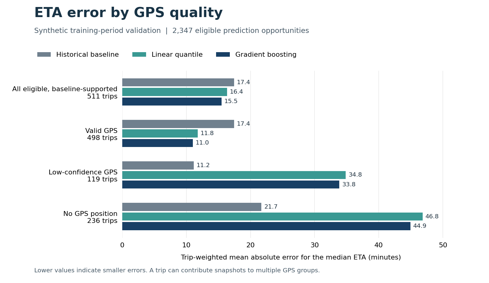

# DS-M01 — ETA intervals and delay alerts

A reproducible data foundation for estimating fleet arrival times and identifying delay risk. **Engineering and Method Demonstration — Synthetic Data.** The pipeline reconstructs what dispatch could know at each prediction time, separates gate arrival from service and delivery completion, and preserves source lineage for every derived record.

**Current stage: chronological model comparison (M3b.3).** Gradient boosting advances to calibration after reducing mean absolute error for the median arrival estimate from 17.43 to 15.48 minutes on 511 synthetic trips. Valid GPS readings drive the gain. The historical baseline gives smaller errors when GPS readings are stale or missing.

All operational observations are original synthetic data for January–September 2026. They are not Rollingtrans customer telemetry or real fleet operating records. Scenario frequencies are engineering fixtures, not estimates of real-world prevalence.

## Which ETA model should advance?

The same 2,347 baseline-supported prediction opportunities were scored for all
three methods. Each trip had equal weight. Linear quantile regression reached
16.36 minutes of median-ETA error and produced the narrowest raw interval.
Gradient boosting reached 15.48 minutes and met the decision rule fixed before
scoring. Across all 5,163 opportunities it delivered its own forecast 5,162
times and the historical fallback once.

On snapshots with low-confidence GPS, boosting's error rose to 33.84 minutes,
compared with 11.15 minutes for the baseline. These subgroups will need separate
checks during calibration. The July calibration period and August–September
final test stay reserved.



[Comparison protocol, cohort definitions and full results](docs/m3b3_comparison.md)

## Check a saved forecast run

From the repository root, create an environment and regenerate the predictions
from the saved models. Python 3.12 was used for the recorded run. This check
needs no Docker, raw outcome file or M2 rebuild.

```bash
python3 -m venv .venv
source .venv/bin/activate
python -m pip install -r requirements-models.lock
python -m pip install -e . --no-deps
python scripts/check_candidate_replay.py --root . --inference-only
```

Expect `status: passed` for 10,326 prediction rows. This checks that the saved
models yield the same forecasts; it does not fit a model or score predictions
against actual arrivals. To run the unit suite, use
`python -m unittest discover -s tests -v` in the same environment.

For exact retraining, follow the [fixed-container guide](docs/reproducibility.md).
For the full data build, [see the commands and disk requirements below](#run-locally).

## Quantile candidate training and inference

Linear and gradient-boosted quantile regressors use fixed defaults and the same
twelve tenant/fold transformers. The 18,343 fit opportunities yield 8,417 eligible
positive remaining-duration targets across 1,869 trip/fold memberships. Expanding
folds reuse trips; these counts do not represent independent observations.

Each family preserves all 5,163 validation opportunities without reading their
outcomes. The resulting 24 model states contain 72 quantile estimators.

| Prediction source, synthetic validation opportunities | Linear quantile | Gradient boosting quantile |
|---|---:|---:|
| Candidate prediction | 4,669 | 5,162 |
| Historical-baseline fallback | 24 | 1 |
| Explicitly unavailable | 470 | 0 |

These are inference availability counts, **not accuracy results or a model
ranking**. Nonpositive raw estimates trigger fallback; crossed positive quantiles
are sorted and flagged. Raw values and all decisions remain in the artifacts.
The raw intervals await calibration. The comparison above uses one fractional-second target and reports separate availability and error denominators for all three methods.

See the [candidate protocol](docs/m3b2_candidates.md),
[retained evidence](reports/m3b2/README.md), historical
[verification](reports/m3b2/verification.json) and
[reproducibility guide](docs/reproducibility.md).

Native macOS retraining failed the original replay check. On Mac Docker Desktop,
two fresh Linux/amd64 containers ran the integrated training command at commit
`0814fa1`. Both reproduced the same four files byte-for-byte: models,
predictions, training rows and summary. The [verification summary](reports/m3b2_integrated_replay_20261031.json)
identifies that commit, the image, the output hashes and the 285 local tests.
These runs did not use July calibration or August–September test labels to
evaluate the candidates.

## Feature preparation

The feature-only runner prepares 7,850 original-training snapshots, builds 12
tenant/fold transformers, and retains all 5,163 chronological validation
opportunities. Stale speed and remaining-distance signals are masked; missing
indicators and unknown-category slots preserve observation limitations. These
counts describe feature preparation, not model accuracy. No target file is
opened, and calibration/final-test groups never enter feature fitting.

The [feature protocol](docs/m3b1_features.md#reproduce) gives the historical
checkout for replaying the five recorded artifacts and the current command for
processing fractional source clocks. See the [feature contract](contracts/m3b1_features.json)
and [retained verification](reports/m3b1/verification.json).

## Historical ETA baseline

The retained M3a experiment predicts remaining gate-arrival time from strictly
prior, tenant-local durations. Route/departure groups fall back to distance bands
or tenant history; insufficient surviving support produces an unavailable result.

| Training-period validation result | Value |
|---|---:|
| Prediction opportunities / trips | 5,163 / 654 |
| Available predictions over all opportunities | 3,357 / 5,163 (65.02%) |
| Eligible, supported snapshots / scored trips | 2,347 / 511 |
| Trip-balanced median-ETA MAE | 17.43 minutes |
| Trip-bootstrap MAE interval (95%, synthetic sample) | 15.96–19.00 minutes |
| Raw P10–P90 coverage / mean width | 77.84% / 67.53 minutes |

The error denominator excludes unsupported and unavailable outcomes, while the
availability denominator retains all opportunities. These synthetic,
training-period results do not measure final-test or operational performance.
The P10/P90 interval has not been calibrated. See the [protocol](docs/m3a_baseline.md)
and [results, denominators and limitations](reports/m3a/README.md).

## Data and engineering results

| Item | M2 result |
|---|---:|
| Trips | 1,800 (200 per month) |
| GPS events | 197,303 |
| Snapshots and corresponding labels | 14,349 each |
| Historical training-trip references | 2,536,045 |
| Provenance records | 2,775,752 |
| Canonical schemas and typed Parquet exports | 28 each |
| Populated data-stage tables | 17 |
| Reserved, empty model and alert tables | 11 |

The pipeline evaluates event time and availability time separately. It selects only promises, positions, device assignments and status versions known at the snapshot. Gate observations supply arrival labels independently of GPS. Historical references are limited to eligible training trips with mature observations available at that time.

Of 14,349 snapshots, 6,966 have eligible labels, 4,272 are not mature, 164 are cancelled and 2,947 were already at the destination before arrival status became known. The eligible total includes 1,122 snapshots assigned to excluded trips; those are not model input. Position quality is valid for 6,394 snapshots, stale (`low_confidence`) for 7,096 and unavailable for 859.

| Split | Trips | Eligible trips | Eligible snapshots |
|---|---:|---:|---:|
| Train | 992 | 805 | 3,670 |
| Calibration | 171 | 130 | 596 |
| Test | 400 | 328 | 1,578 |
| Excluded | 237 | 195 | 1,122 |

See the [data validation guide](docs/data_validation.md) for figures and interpretation, and [generator assumptions](docs/generator_assumptions.md) for route geometry, observation delays and scenario design.

## Validation evidence

The retained M2 execution receipts record:

- **49 unit tests, 27 warehouse checks and 22 readiness checks passed.** Readiness is `ready_for_m3_with_cautions`, not a model or deployment approval.
- **M1 continuity:** the 120-trip M1 business rows and all 937 snapshot/label rows remain exact subsets. Under the original M1 configuration, the optimized pipeline reproduces all seven M1 processed JSONL files byte-for-byte.
- **HTTP transport:** 1,441 pages received, one injected 503 retried and 137 duplicate records replayed, with no added canonical rows. All 197,303 received GPS records match the canonical source.
- **Fresh rebuild:** SHA256 equality for 48 source, processed and Parquet files, plus equality for seven HTTP-derived outputs.

The evidence is in [unit test results](reports/unittest_results.txt), [warehouse checks](reports/quality_report.json), [M2 readiness](reports/m2_readiness.json), [M1 pipeline compatibility](reports/pipeline_m1_compatibility.json), [HTTP results](reports/last_http-check.json) and [rebuild results](reports/rebuild_report.json). Historical M1 receipts are retained separately in [reports/m1_reference/](reports/m1_reference/).

These are historical M1/M2 execution results. The documentation and reporting cleanup did not rerun the full M2 dataset; its current checks are recorded separately in [public cleanup validation](reports/public_cleanup_validation.json).

M3a's fresh M2 replay, extended tests, input-hash checks and deterministic baseline
replay are recorded separately in [M3a verification](reports/m3a/verification.json).
The older receipts above have not been rewritten to describe the new run.

## Run locally

The native data workflow uses Python 3.11 or later; the recorded full build
ran on Linux with Python 3.12.14. Use the environment from
[the saved-forecast check](#check-a-saved-forecast-run). A full native macOS
data rebuild has not been verified.

Budget about **30 GB of free disk space** for a fresh M2 rebuild and HTTP checks.
The complete generated dataset occupies about 12.6 GB uncompressed. Peak memory
use in the recorded build was 7.23 GiB. Generated data are excluded from Git;
no company files, paid APIs or credentials are required.

Generate the complete M2 dataset and run its checks from the repository root:

```bash
python -m ds_m01.cli run --root . --config config/m2.json
python -m ds_m01.cli http-check --root . --config config/m2.json
python scripts/check_m2_readiness.py --root .
python scripts/check_rebuild.py --root . --config config/m2.json
```

`run` replaces generated data in the selected root, and checks can update tracked reports. Use a separate checkout to retain the published reports for comparison. Explicit `--config` selects the reproducible configuration; the CLI otherwise defaults to `config/m2.json` when present. The smaller historical configuration is [config/m1.json](config/m1.json); use a separate project copy for M1 experiments to keep M2 outputs distinct.

With the frozen M2 model inputs available, run training-only baseline validation:

```bash
python -m ds_m01.baseline_run --root . --config config/m3a.json --output reports/m3a_local
```

Choose a new output directory for a subsequent run. See the [M3a protocol](docs/m3a_baseline.md)
for the exact required inputs, output files and figure command.

Use [plot_data_quality.py](scripts/plot_data_quality.py) to regenerate the English validation figures from the retained summary reports:

```bash
python -m pip install -e '.[plots]'
python scripts/plot_data_quality.py --root .
```

## Scope and limitations

The 11 reserved tables have declared types and nullability but no model, alert, notification or action records. Their population and later-stage behavior remain unimplemented. Native PostgreSQL verification is also pending; see the [PostgreSQL runtime note](docs/postgres_runtime_note.md). DuckDB and HTTP validation do not establish PostgreSQL integration.

For the next modeling stage, the unseen-route-only test cohort has 29 eligible trips and the joint unseen-vehicle/unseen-route cohort has four. These sparse cohorts support descriptive reporting, not reliable deployment claims. A threshold of 30 trips is a coverage warning, not a power analysis. The training set also contains 97 eligible snapshots without a prior historical pool, requiring a defined fallback or unavailable result.

Keep split boundaries and heldout IDs frozen. Do not tune on final test outcomes or count snapshots from the same trip as independent trips. The next stage defines delay relative to the promise available at prediction time and evaluates classifiers within the training period. Later stages cover probability and interval calibration, frozen final evaluation, alert delivery and action follow-up.

## Repository guide

| Location | Purpose |
|---|---|
| [src/ds_m01/](src/ds_m01/) | Data pipeline, historical baseline, chronological validation, transport and PostgreSQL adapter |
| [config/](config/), [contracts/](contracts/), [sql/](sql/) | Reproducible configurations, requirements and typed schema definitions |
| [tests/](tests/) | Independent temporal fixtures, build invariants, transport and publication checks |
| [scripts/](scripts/) | Rebuild, readiness, generator stability, candidate replay and figure generation |
| [reproducibility/m3b2/](reproducibility/m3b2/), [reproducibility guide](docs/reproducibility.md) | Fixed candidate runtime, integrity contract and observed execution scope |
| [reports/](reports/) | Execution receipts, data summaries and validation figures |
| [docs/m1_scope.md](docs/m1_scope.md), [docs/m2_scope.md](docs/m2_scope.md) | Historical trial scope and full data milestone scope |
| [docs/m3a_baseline.md](docs/m3a_baseline.md) | Historical baseline, fold cutoffs, protected periods and metric denominators |
| [docs/change_log.md](docs/change_log.md) | Implementation changes and technical findings |

A full run creates `data/raw/`, `data/processed/`, `data/parquet/` and `data/ds_m01_m2.duckdb`. `data/source_manifest.json` guards the 13 raw sources with counts and SHA256 digests. Generated `validation/` artifacts contain engineering-only synthetic truth and must never become model features.
