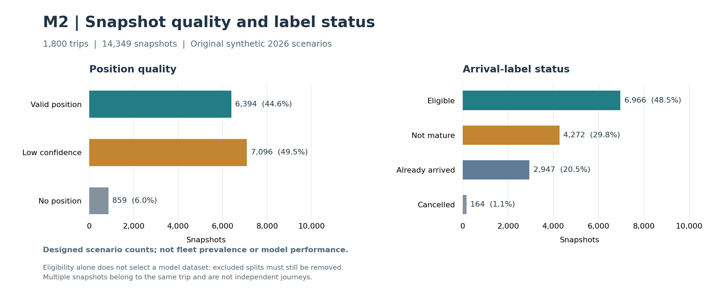
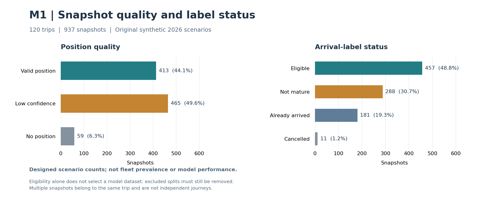

# Data validation and quality figures

DS-M01 currently evaluates a data pipeline, not a trained ETA model. The retained
receipts describe original synthetic 2026 scenarios and engineering checks. Their
counts are not estimates of real fleet prevalence, predictive accuracy or business
impact.

## Recorded data milestones

| Measure | M1 trial | M2 full data |
|---|---:|---:|
| Trips | 120 | 1,800 |
| Snapshots | 937 | 14,349 |
| Valid position | 413 | 6,394 |
| Low-confidence position | 465 | 7,096 |
| No position | 59 | 859 |
| Eligible arrival labels | 457 | 6,966 |
| Labels not yet mature | 288 | 4,272 |
| Already-arrived labels | 181 | 2,947 |
| Cancelled-trip labels | 11 | 164 |

The position categories and label categories each sum independently to the
snapshot count. A snapshot may be label-eligible even if its trip belongs to an
excluded split. In M2, 1,122 of the 6,966 eligible snapshots belong to excluded
trips. Modeling must apply both eligibility and the frozen split assignments.
Multiple snapshots from the same trip are correlated and must not be treated as
independent trips when assessing uncertainty.





## Reproduce the figures

From the repository root, install the optional plotting dependency and run:

```bash
python -m pip install -e '.[plots]'
python scripts/plot_data_quality.py --root .
```

The script reads
[`reports/m1_reference/m1_summary.json`](../reports/m1_reference/m1_summary.json)
and [`reports/m2_summary.json`](../reports/m2_summary.json). It validates the
category names, nonnegative integer counts and snapshot totals before rendering
either figure. It does not regenerate trips, fit a model or rewrite the summary
receipts. The two output paths are the images embedded above.

## Evidence and interpretation

- [`reports/quality_report.json`](../reports/quality_report.json) records the M2
  warehouse checks: all 27 passed in the recorded run.
- [`reports/m2_readiness.json`](../reports/m2_readiness.json) records 22 M2
  coverage and point-in-time readiness checks. It also records sparse test
  cohorts and unsupported historical-pool cases that must be handled in modeling.
- [`reports/rebuild_report.json`](../reports/rebuild_report.json) records a fresh
  M2 rebuild: 48 raw, processed and Parquet files had identical SHA-256 digests;
  seven HTTP-derived outputs were byte-identical to their file-derived counterparts.
- [`reports/last_http-check.json`](../reports/last_http-check.json) records the
  loopback HTTP integration run, including pagination, one injected transient
  failure and duplicate replay.
- [`reports/unittest_results.txt`](../reports/unittest_results.txt) records the
  49 passing unit tests at the M2 data milestone. Its environment and file paths
  describe that historical execution.
- [`reports/m1_reference/`](../reports/m1_reference/) preserves the earlier
  trial's machine-readable results for comparison.

These are historical execution receipts, retained without rewriting their hashes
or timestamps. Localizing descriptions or redrawing charts is not a new full-data
rebuild. Compatibility validation for the public-content revision is recorded
separately in
[`reports/public_cleanup_validation.json`](../reports/public_cleanup_validation.json).

The warehouse defines 28 tables: 17 contain data and 11 remain empty placeholders
for later modeling and alert workflows. No ETA model, calibrated prediction
interval or delay-alert policy has been evaluated yet. The native PostgreSQL
roundtrip has not run in the recorded environment; the DuckDB and HTTP checks do
not substitute for it. See
[`postgres_runtime_note.md`](postgres_runtime_note.md) for the service check and
[`m2_scope.md`](m2_scope.md) for the milestone boundary.
