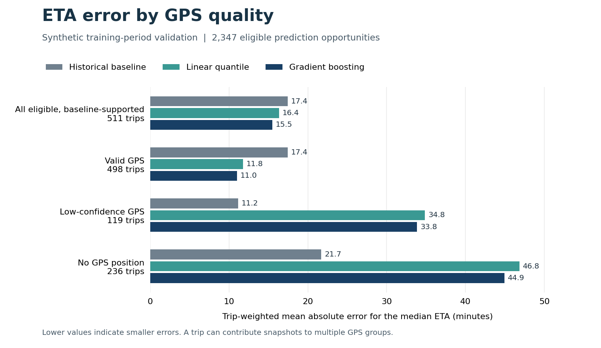

# Choosing an ETA model for calibration

Carry the gradient-boosted quantile model forward with the historical baseline as its fallback. On 2,347 comparable training-period snapshots from 511 trips, the boosted model reduced the trip-weighted mean absolute error of the median ETA from **17.43 to 15.48 minutes**. It did substantially worse when GPS was stale or missing. Those cases need separate attention at calibration. The data are synthetic.

## What was compared

The historical baseline and both M3b.2 candidates each accounted for the same 5,163 prediction opportunities from 654 trips. The four disjoint validation windows cover March–June inside the original training partition. Each method retained its forecasts, transformer, historical pool and fallback decisions from the preceding stages. The evaluation joins labels after prediction. The fitting parameters and forecasts stay fixed throughout the comparison.

For every validation trip, the loader selects the latest outcome known **strictly before that fold's validation-label cutoff**. A verified gate arrival with second or minute source precision and positive time remaining provides the target. All three methods use the same fractional seconds from snapshot to gate arrival. The loader reconciles the chosen outcome version, eligibility and whole-second representation against the M3a reference. All 2,358 eligible targets in this run had fractional seconds. The remaining opportunities comprise 2,112 immature outcomes, 638 snapshots taken after physical arrival but before arrival was known, and 55 cancellations. They still count toward availability.

| Method | Own forecast | Historical fallback | Unavailable | Delivered / all |
|---|---:|---:|---:|---:|
| Historical baseline | 3,357 | 0 | 1,806 | 65.0% |
| Linear quantile | 4,669 | 24 | 470 | 90.9% |
| Gradient-boosted quantile | 5,162 | 1 | 0 | 100.0% |

The shared raw outcome file also contains July and final-test records. The reader hashes and decodes that file, selects training-period validation trip identities, then uses only their outcome versions known before the corresponding fold cutoff. The receipt records the exact input hashes and the label counts. [Run receipt](../reports/m3b3/run_receipt.json)

## Decision rule

The [decision protocol](../config/m3b3.json) was fixed before joining candidate predictions to validation targets. It defines four populations. **Native** uses each method's own available quantiles. **Common native** uses only opportunities with native quantiles from all three. **Delivered** includes a method's recorded historical fallback. The **baseline anchor** contains every eligible opportunity where the historical baseline could forecast. All methods must cover that complete set to earn an anchor score. This keeps a model from winning by omitting hard cases.

A candidate had to preserve all 3,357 supported baseline opportunities, including those without a scoreable target, and supply its own forecast on at least 90% of them. On the baseline anchor it needed at least 5% lower P50 MAE, mean pinball loss no greater than the baseline, and a paired 95% interval for the MAE difference strictly below zero. Among candidates passing all gates, the simpler candidate wins if its MAE is within 1% of the best. The default is the historical baseline. These thresholds govern this development decision only. [Decision record](../reports/m3b3/selection.json)

For every cohort and slice, snapshots share one unit of weight within each scored tenant/trip. The metric then averages the contributions of those trips. RMSE takes the square root after averaging squared errors. Pinball loss is reported for P10, P50 and P90 and as an equally weighted mean across the three. Interval coverage counts targets between P10 and P90 inclusive. Width is P90 minus P10. The paired interval resamples complete trip contributions within each fold 1,000 times, preserving each fold's trip count. It quantifies sampling variation for these frozen models and synthetic trips. Shared vehicles, common traffic patterns and refitting can introduce additional uncertainty.

## Results on the baseline anchor

All figures below use the **same 2,347 snapshots and 511 trips**. The JSON retains seconds at full precision. This table uses minutes for interpretation.

| Method | P50 MAE | P50 RMSE | Mean pinball | Raw P10–P90 coverage | Mean width |
|---|---:|---:|---:|---:|---:|
| Historical baseline | 17.43 | 27.43 | 6.30 | 77.8% | 67.53 |
| Linear quantile | 16.36 | 28.02 | 5.07 | 80.5% | 48.52 |
| Gradient-boosted quantile | 15.48 | 27.40 | 5.33 | 82.1% | 63.88 |

Both candidates qualified. The boosted model reduced anchor MAE by 11.19%, with a paired candidate-minus-baseline interval from **−179.0 to −59.9 seconds**. Linear reduced MAE by 6.13%, with an interval from −122.4 to −6.8 seconds. Its narrower intervals also gave it the lowest mean pinball loss. The selection rule prioritizes median error among candidates passing the quantile and availability gates, so it advances boosting. Raw interval coverage here describes these folds only.

As a check on the cohort choice, all three methods gave native forecasts on 2,345 eligible snapshots. Their MAEs were 17.43, 16.37 and 15.48 minutes in the same order. On each method's own native set the MAEs were 17.43 (2,347 snapshots), 16.23 (2,357) and 15.35 (2,357) minutes. Those different populations explain why the decision uses the fixed baseline anchor. [Full metrics and denominators](../reports/m3b3/metrics.json)



## Where the conclusion changes

| GPS state on the baseline anchor | Scored trips | Baseline MAE | Boosted MAE | Boosted raw interval coverage |
|---|---:|---:|---:|---:|
| Valid | 498 | 17.45 min | 11.02 min | 82.9% |
| Low confidence | 119 | 11.15 min | 33.84 min | 72.7% |
| No position | 236 | 21.69 min | 44.92 min | 71.2% |

A trip can appear in multiple GPS or elapsed-time slices as conditions change, so those trip counts do not add to 511. The baseline also performed better in the first hour of a trip (19.85 versus 25.22 minutes). Boosting lowered aggregate MAE in each of the four chronological folds, but the baseline had lower error on several individual routes. The route-plus-departure historical pool contained only nine scored trips, and the afternoon departure band contained two. Neither supports a stable estimate for that subgroup.

The slice table reports fold, tenant, type of historical route support, and GPS quality; it also breaks out each route, local six-hour departure period and elapsed-time band. Slices with fewer than 20 scored trips are flagged `sparse`. Each trip receives equal weight within its slice. The supplementary route, time and elapsed-time comparisons are descriptive. [All slices](../reports/m3b3/slices.csv)

## Reproduce

With the repository installed, run the following from its root. Supply the frozen `eta_trip_outcome.jsonl` from the M2 build or the verified replay package. Its SHA256 is `4de63a3302783534bcc6368591721f7c22048a5cd3040567ba5b7d59c7f58a58`.

```bash
python -m ds_m01.comparison_run --root . --output reports/m3b3_local
```

If the outcomes are stored elsewhere, add `--outcomes /path/to/eta_trip_outcome.jsonl`. Use a fresh output directory. The runner checks source hashes, publishes the four result files together, and rejects an existing destination. Repeated runs with the same inputs can compare `metrics.json`, `selection.json`, `slices.csv` and `run_receipt.json` byte for byte. The comparison uses Python's standard library and the retained predictions.

M3c.1 next defines the delay outcome against the commitment window known at each prediction time. The ETA model will need its own refit and July calibration protocol, with explicit checks for low-confidence/missing GPS, early-trip errors and interval width. A policy that switches methods based on those observations would require a new evaluation. August–September remains reserved for final testing. Operational alert performance and fleet benefit require subsequent evidence.

The [independent scoring checks](../reports/m3b3/independent_checks.json) recompute aggregate results, subgroup scores and selection gates using SQL and a separate Python implementation.
