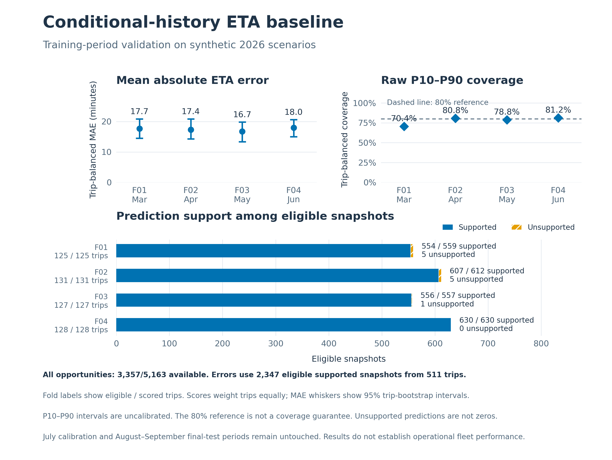

# M3a baseline validation result

Executed on 2026-10-28 using the frozen synthetic 2026 M2 inputs. This is
training-period chronological validation, not final-test or fleet performance.
The [protocol](../../docs/m3a_baseline.md) defines the information boundary,
historical pool, cutoffs, fallback and metric weights.

## Results and denominator

| Measure | Result |
|---|---:|
| All validation opportunities / trips | 5,163 / 654 |
| Available predictions, irrespective of later label status | 3,357 (65.02% of opportunities) |
| Unsupported predictions | 1,806 |
| Eligible targets / trips | 2,358 / 511 |
| Eligible and supported snapshots / trips used for errors | 2,347 / 511 |
| Support among eligible snapshots | 99.53% |
| Trip-balanced MAE | 17.4341 minutes |
| Trip-bootstrap 95% MAE interval | 15.9560–18.9997 minutes |
| Trip-balanced RMSE | 27.4277 minutes |
| Trip-balanced signed bias (prediction minus actual) | -1.5839 minutes |
| Raw P10–P90 coverage | 77.8369% |
| Mean raw interval width | 67.5253 minutes |

Coverage and errors weight each scored trip equally, then its scored snapshots
equally. Availability is a snapshot count ratio. The 99.53% eligible-support
ratio must not be presented as availability over all prediction opportunities.
The scored subset contains mature, positive remaining-time targets only.

| Fold | Eligible trips | Scored snapshots | MAE (minutes) | Raw interval coverage |
|---|---:|---:|---:|---:|
| F01, March | 125 | 554 | 17.6996 | 70.3683% |
| F02, April | 131 | 607 | 17.3544 | 80.7997% |
| F03, May | 127 | 556 | 16.7262 | 78.7636% |
| F04, June | 128 | 630 | 17.9586 | 81.1788% |

## What the result shows

- Only 44 opportunities select the exact route/departure pool. Distance-band
  fallback supplies 2,961 predictions and tenant-global fallback supplies 352.
  The exact weekday/hour grouping is sparse in this synthetic design.
- The 1,806 unsupported predictions comprise 1,314 not-mature, 481 already-arrived
  and 11 eligible targets. Each has either no surviving historical duration or
  fewer than five survivors. These cases remain in the output, not silently
  converted into zero-duration or on-time predictions.
- The full label audit retains 2,112 not-mature, 638 already-arrived and 55
  cancelled opportunities in addition to the 2,358 eligible targets.
- Raw coverage varies from 70.37% to 81.18% across windows. The 80% reference is
  not a guarantee. Interval calibration remains pending, and no delayed-arrival
  probability is inferred from the interval.

These are baseline diagnostics, not evidence that dispatch, cost or customer
outcomes improved. The synthetic scenario mix, long observation delays and
conditional scoring denominator limit operational interpretation. The trip
bootstrap handles repeated snapshots within a trip; it does not establish
independence across vehicles, tenants or adjacent dates.

## Verification

- 102 unit tests passed, including prior-revision reconstruction, label-independent
  predictions, protected-period payload isolation, fallback and trip weighting.
- A fresh 1,800-trip M2 pipeline replay passed all 27 warehouse checks. The eight
  inputs consumed by this experiment matched the retained M2 SHA256 values.
- Two baseline executions produced identical SHA256 values for all six core
  outputs. Execution timestamps are retained separately in their receipts.
- No calibration, final-test scoring, candidate model selection, PostgreSQL
  validation or operational alert delivery is claimed.

See [verification.json](verification.json), [unit test output](unittest_results.txt),
[run receipt](run_receipt.json), [repeat receipt](replay_receipt.json),
[full metrics](metrics.json) and [model manifest](model_manifest.json).

## Next comparison

Use the same training-only folds to evaluate a candidate remaining-time model
against this frozen baseline. Report paired results on shared support and the
coverage of each method separately. Consider alternative departure grouping as
an explicit training-validation experiment, not an unrecorded rewrite of this
baseline. Fit/freeze the selected method before July calibration, and evaluate
the August–September test once the complete protocol is fixed.
