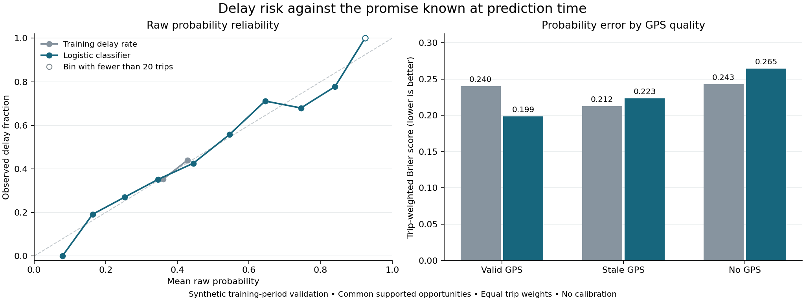

# Raw delay probability results

The fixed logistic classifier reduces probability error across the full scored
cohort, with weaker results for stale/missing GPS and the final 30 minutes before
the promise deadline. The configuration is retained for July calibration.
There is no calibrated probability, chosen notification threshold or final-test
result at this stage.

## Cohort and scores

Both methods produce 5,163 probabilities for 654 original-training trips in four
chronological validation folds. Evaluation uses the same 2,358 eligible
snapshots from 511 trips, with equal total weight per trip. Each tenant/fold has
one prevalence model and one logistic model, for 24 available states. Neither
method needs fallback in this run.

| Metric | Training prevalence | Logistic classifier |
|---|---:|---:|
| Brier score | 0.239267 | 0.206144 |
| Log loss | 0.671415 | 0.598813 |
| Average precision | 0.415302 | 0.627379 |
| ROC AUC | 0.532712 | 0.717809 |
| Fixed-bin calibration error, descriptive | 0.009835 | 0.026179 |
| Mean raw probability | 0.398161 | 0.398335 |

The trip-weighted observed delay fraction is 0.401631. There are 1,149 delayed
and 1,209 on-time scored snapshots. Positive and negative trip counts are 215
and 312; 16 trips contribute both labels because their effective promises
change between snapshots. Those counts overlap and must not be added as
independent trips.

The 2,805 unscored opportunities remain in the output: 1,392 incomplete, 720
pending, 638 already arrived and 55 cancelled. None becomes an on-time label.
Training separately retains 18,343 fit opportunities, of which 8,417 have
eligible targets across 1,869 trip/fold memberships. Expanding-fold reuse makes
that membership count larger than the number of unique trips.

The baseline's smaller bin-based calibration error does not make it the better
ranker. Its probabilities are concentrated around tenant/fold prevalence.
Brier and log loss also reflect the ability to separate risk. These raw
diagnostics support a separate calibration experiment, not a calibration claim.

## Where the gain is limited

Each row below reweights its own scored trips equally. Trips can appear in more
than one slice, so row counts and row averages should not be pooled directly.

| Slice | Scored snapshots / trips | Baseline Brier | Logistic Brier |
|---|---:|---:|---:|
| Valid GPS | 1,921 / 498 | 0.2402 | 0.1986 |
| Stale GPS | 201 / 119 | 0.2125 | 0.2235 |
| No GPS | 236 / 236 | 0.2429 | 0.2647 |
| First hour of trip | 1,022 / 511 | 0.2424 | 0.2162 |
| More than two hours before deadline | 438 / 212 | 0.2461 | 0.2325 |
| 30–120 minutes before deadline | 1,379 / 511 | 0.2387 | 0.2007 |
| 0–30 minutes before deadline | 335 / 335 | 0.2760 | 0.2958 |
| Deadline already passed | 206 / 105 | 0.3538 | 0.1160 |

All 206 overdue scored snapshots are delayed. Their ranking metrics are
undefined because they have only one class, and their result does not establish
advance warning. No threshold or subgroup-specific model switch was selected
after seeing these results. The complete 656 slice rows retain sparse-support
flags and undefined-metric reasons.



Open reliability markers have fewer than 20 contributing trips. The curve is
an assessment of saved raw predictions; it is not a fitted calibration curve.

## Reproduce

Use Python 3.12 with the repository's existing `requirements-models.lock` and
editable package installation. Portable inference uses the saved JSON models:

```bash
python -m ds_m01.delay_replay --root .
```

This should return `status: passed`, `prediction_rows: 10326` and
`differences: 0`. It does not open the raw outcome source or fit models. Supply the exact three
M2 files under a separate root to also reconstruct labels, weights and scores:

```bash
python -m ds_m01.delay_replay --root . --inputs /path/to/frozen_m2
```

Required paths beneath that root are `data/processed/eta_snapshot.jsonl`,
`data/raw/eta_promise_version.jsonl` and `data/raw/eta_trip_outcome.jsonl`.
Their hashes are fixed in `config/m3c.json`. This mode additionally requires
`targets_verified: true` and `metrics_verified: true`, with no refitting.

To fit and evaluate a new run in a new output directory:

```bash
python -m ds_m01.delay_run --root . --inputs /path/to/frozen_m2 \
  --output /path/to/new_delay_run --evaluate
```

Omitting `--evaluate` leaves validation outcomes unjoined and produces the
training/inference artifacts only. The recorded fit used Linux and pinned model
dependencies. Cross-platform exact retraining has not been established. The
portable replay uses absolute tolerance `1e-12` and relative tolerance `1e-10`
for numeric values, while requiring exact identity and categorical fields.

Run the complete unit suite with `python -m unittest discover -s tests -v`.
To regenerate the figure after installing the existing optional `plots` extra,
run `python scripts/plot_delay_quality.py --root .`.

## Retained evidence

| File | Content |
|---|---|
| `models.json` | 24 tenant/fold states, fit membership, support, coefficients and feature transforms |
| `predictions.jsonl` | 10,326 label-free raw probabilities and promise/model bindings |
| `training_rows.jsonl` | Every fit opportunity, cutoff-specific target, eligibility and weight |
| `promise_features.jsonl` | Snapshot-effective promise metadata for the frozen feature opportunities |
| `evaluation_rows.jsonl` | Predictions joined to cutoff-specific validation targets after fitting |
| `metrics.json`, `reliability.csv`, `slices.csv` | Cohort, class-support, reliability and slice results |
| `run_receipt.json` | Input, configuration, implementation, runtime and output hashes |
| `prefit_review.json` | Protocol hash and source checks recorded before the first fit |
| `independent_checks.json` | Separate source/label and sklearn/pandas metric comparisons |
| `verification.json`, `unittest_results.txt` | Recorded execution scope and full suite result |
| `replay_inference.json`, `replay_source.json` | Portable inference and source-derived label/metric checks |

The [protocol](../../docs/m3c_delay.md) explains temporal rules and exclusions.
Canonical model, evaluation-membership and prediction tables remain empty;
these are retained experiment artifacts. July calibration, final-test scoring
and operational integration remain separate work.
