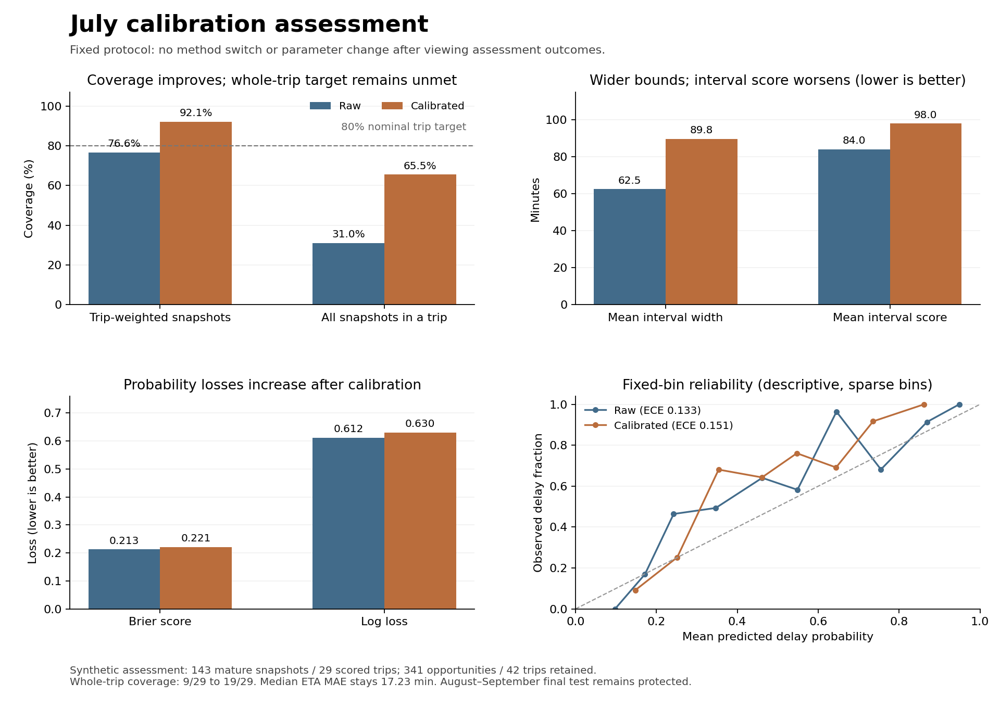

# July calibration assessment

**Engineering and Method Demonstration — Synthetic Data.** Fixed calibration
methods were fitted on early July trips and assessed on a later, separate July
cohort. Interval expansion increased coverage but did not attain its nominal
80% whole-trip target. Probability calibration worsened Brier score and log loss.
This is a completed experiment with reported limitations, not an operational
approval or a final-test result.

## What was frozen before assessment?

The [protocol](../../docs/m3d_calibration.md) fixes the model families, input
hashes, feature definitions, time windows, minimum support, calibration methods
and assessment metrics. The original M2 trip groups and heldout IDs are retained.
Refit R01 uses 7,850 training snapshots from the original 992-trip training
cohort with a July 1, 00:00 PDT knowledge cutoff. July does not select base-model
features or hyperparameters. Raw forecasts are saved before joining July labels.

| Role, based on whole-trip departure date | Trips / forecast opportunities | Exclusive label cutoff |
|---|---:|---|
| Calibration fit: July 1–10 | 78 / 636 | July 15, 00:00 PDT |
| Buffer: July 11–14 | 51 / 381 | No target use |
| Assessment: July 15–24 | 42 / 341 | August 1, 00:00 PDT |

Calibration fitting has 242 eligible snapshots from 53 trips for each target in
this run. T01, T02 and T03 contribute 18, 17 and 18 fit trips. ETA and binary
target eligibility are computed separately: ETA permits verified second/minute
arrival precision, while the binary deadline target requires second precision.
Their denominators happen to match here; this is not an assumed contract.

The interval method uses each fit trip's maximum nonnegative CQR score and a
finite-sample order statistic for nominal 80% coverage. Expansion floors the
lower bound at zero and leaves the median unchanged. Its endpoints are coverage
bounds, not re-estimated P10/P90 quantiles. The probability method fits a
monotone sigmoid of clipped raw log-odds, with the fixed penalty and trip weights
specified in the protocol. Calibration-fit scores and objective values are
fitting diagnostics; calibrated forecasts are not evaluated on those fit trips.

## Later July assessment

Both raw and calibrated pipelines retain every one of the 341 opportunities.
Scoring uses the same 143 eligible snapshots from 29 trips; the other 198 remain
explicit exclusions. Each scored trip has unit total weight, divided among its
scored snapshots for snapshot metrics. All eligible snapshots have forecasts.

| July assessment metric | Raw pipeline | Calibrated pipeline |
|---|---:|---:|
| Trips with every eligible snapshot covered | 9/29 (31.0%) | 19/29 (65.5%) |
| Trip-weighted snapshot coverage | 76.6% | 92.1% |
| Mean interval width | 62.53 min | 89.75 min |
| Brier score, lower is better | 0.2129 | 0.2208 |
| Log loss, lower is better | 0.6120 | 0.6303 |

| Additional measure | Raw | Calibrated |
|---|---:|---:|
| Mean interval score, alpha 0.2; lower is better | 84.02 min | 97.97 min |
| Median ETA MAE | 17.23 min | 17.23 min |
| Fixed-bin reliability error | 0.1327 | 0.1509 |
| ROC AUC | 0.7466 | 0.7546 |
| Average precision | 0.7954 | 0.7970 |

A trip is covered only when every eligible snapshot has an interval and is
inside it. Missing intervals count as misses in the all-eligible-trip denominator.
Since all 29 eligible trips have full availability, coverage conditional on full
availability is also 19/29. The 92.1% snapshot metric answers a different question
and cannot establish the 80% whole-trip target. Temporal dependence and
maturity-based selection do not establish the exchangeability needed for a
future-coverage guarantee.

The binary cohort contains 97 delayed and 46 on-time snapshots. Eighteen trips
contribute delayed labels, thirteen contribute on-time labels, and two contribute
both as snapshot-effective promises change. The trip-weighted event rate is
58.6%. Probability loss and fixed-bin reliability error worsen after calibration.
Small pooled ranking changes do not reverse that finding: separate tenant maps
can change cross-tenant ranks. No calibrator was selected, retuned or disabled
based on its assessment result.



The full metrics retain tenant, route, GPS validity, early-trip, deadline-advance
and native/fallback strata with support counts. Groups below 20 scored trips are
marked sparse. The entire scored assessment has only 29 synthetic trips; its
results do not establish performance on a real fleet or within every subgroup.

## Support and remaining boundaries

All three tenant interval calibrators and all three probability calibrators were
fitted. Every assessment forecast came from the native selected model; no
base-model fallback or unsupported calibrator was exercised by this retained
assessment. Those branches are tested separately. Insufficient support preserves
the raw interval or raw probability with `calibration_status=unsupported`.
It is not counted as successful calibration. Invalid values, missing bindings,
or solver failures stop the run rather than invoking that support fallback.

P05 assesses the predeclared calibration methods. The same July assessment
cohort may be used for P06 alert-policy development, so it cannot subsequently
be described as an independent final-policy test. August–September outcomes
remain outside fitting, selection and scoring. No alert threshold, notice-time
rule, notification delivery, production release or operational benefit has been
validated here. Canonical model and prediction tables remain empty; these are
separate experiment artifacts.

## Check the retained run

From an installed repository environment, replay the saved base-model inference,
calibration application and assessment metrics:

```bash
python -m ds_m01.calibration_replay --root . --report reports/m3d
```

This reads retained assessment labels for scoring, but does not open the raw
outcome source or fit base models or calibrators. To reconstruct role assignments,
features, and July calibration-fit and assessment targets from the exact eight
source files, supply their root:

```bash
python -m ds_m01.calibration_replay --root . --report reports/m3d --input-root /path/to/frozen-m2-root
```

This source replay does not independently audit the original training labels.
The expected file digests are in [config/m3d.json](../../config/m3d.json). Both
checks must report `status=passed` and `differences=0`; the second also reports
`source_targets_verified=true`. A full new fit uses a new output directory:

```bash
python -m ds_m01.calibration_run --root . --input-root /path/to/frozen-m2-root --output /new/path/p05-run
```

The [run receipt](run_receipt.json) binds code, inputs and outputs. Replaying saved
models is distinct from demonstrating identical native training on another
platform. The [verification record](verification.json), [unit-test log](unittest_results.txt),
[inference replay](replay_inference.json), [source replay](replay_source.json),
[independent checks](independent_checks.json) and [repeatability record](reference_repeatability.json)
describe their own recorded execution scopes. Earlier P03/P04 evidence remains
unchanged and refers to its original models and training-period cohorts.

The recorded suite passed 416 tests with no failures, errors or skips. Both
retained replay modes reported zero differences. An independent implementation
made 213,496 comparisons without a failure, with a maximum numeric difference
of 3.64e-12 under its stated tolerances. That audit rebuilds July calibration-fit
and assessment targets; it is not an independent audit of the original training
labels. Ten refit, forecast and calibrator artifacts were byte-identical across
two executions in the same Linux runtime. These engineering checks do not imply
native Mac fitting equivalence or change the observed calibration-quality result.

## Artifact map

| Files | Purpose |
|---|---|
| `protocol_freeze.json`, `run_receipt.json` | Pre-fit protocol binding and recorded execution |
| `memberships.jsonl`, `features.jsonl`, `matrices.jsonl` | Whole-trip roles and frozen training-only preprocessing |
| `refit_*` | Base models, transformer/history state and refit counts |
| `eta_training_rows.jsonl`, `delay_training_rows.jsonl` | Training eligibility and weights |
| `eta_predictions.jsonl`, `delay_predictions.jsonl`, `baseline_predictions.jsonl` | Raw forecasts with native/fallback identities |
| `promise_features.jsonl` | Snapshot-effective deadline bindings |
| `calibration_fit_*_rows.jsonl`, `calibrators.json` | Fit-only targets, trip scores, support and saved calibration states |
| `assessment_*_rows.jsonl`, `metrics.json`, `summary.json` | Paired assessment outputs, exclusions, diagnostics and strata |
