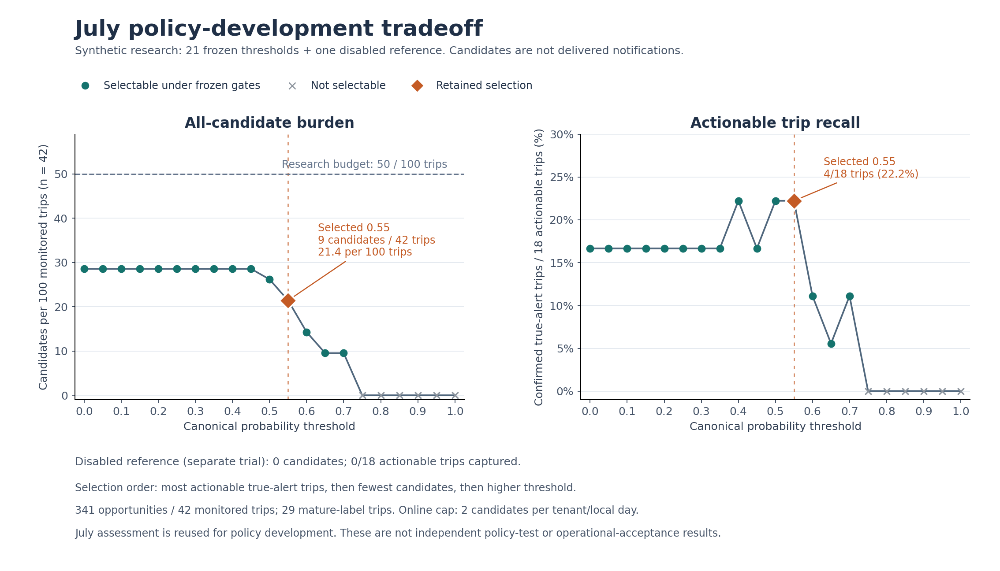

# July alert-policy development and offline outputs

The frozen sweep selected a **0.55 probability threshold**, with a 30-minute minimum prospective notice, 30-minute repeat suppression and a two-candidate daily cap per tenant. It produced nine candidates across 42 monitored trips, but captured only **4 of 18 actionable delayed trips (22.2%)**. This is a development result on the reused P05 July assessment cohort. Selecting and reporting on the same outcomes introduces selection optimism; these figures are not an unbiased estimate of future policy performance or deployment approval.

The 50-candidates-per-100-trips budget and daily cap are hypothetical research settings, fixed before this sweep after the P05 assessment results were already known. They are not measured fleet capacity. No model or calibrator was refitted or reselected. The [protocol](../../docs/p06_alert_policy.md) and [configuration](../../config/p06.json) define all 21 thresholds, the disabled reference, candidate ordering and tie-breaks.

## What was measured?

The development cohort contains 341 opportunities from 42 July 15–24 trips. Mature targets were available at 143 snapshots from 29 trips; 198 target exclusions remain in the opportunity accounting. The outcome knowledge cutoff is August 1 00:00 Los Angeles time, exclusive. August–September final-test targets were not used.

All 341 opportunities had available forecasts and fitted probability calibration. The policy uses the same six-decimal, half-even probability stored in the formal prediction table. Targets are joined by a separate scorer after the decision stream is generated. Unknown targets never become negative labels or disappear from candidate burden.

| Selected-policy measure | Development result |
|---|---:|
| Admitted candidates / monitored trips | 9 / 42 |
| Candidates per 100 monitored trips | 21.43 |
| Trips with an admitted candidate | 7 |
| Confirmed actionable delayed trips captured | 4 / 18 (22.2%) |
| Recall over all observed positive trips | 4 / 18 (22.2%) |
| First candidates with eligible positive / negative targets | 4 / 2 |
| Conditional first-candidate precision | 4 / 6 (66.7%) |
| Unresolved first candidates | 1 of 7 |
| First-candidate target coverage | 6 / 7 (85.7%) |
| All-candidate target coverage, including repeats | 8 / 9 (88.9%) |
| All-first-candidate usefulness bounds | 4 / 7 to 5 / 7 (57.1%–71.4%) |
| Repeated candidates within an episode | 2 |
| Candidates retrospectively after physical arrival | 0 |

The unresolved candidate belongs to a trip whose latest cutoff-known outcome was cancelled. It still consumed capacity. The usefulness bounds assign that unresolved first candidate to neither or to the useful group; they are identification bounds, not confidence intervals. Conditional precision excludes it and has a different denominator. The two repeat candidates are counted in burden, not as additional captured trips. Two trips have both positive and negative snapshot labels under different promises; the report does not collapse those into one immutable trip label.

The 341 decisions comprise nine admitted candidates, 132 below-threshold decisions, 177 with insufficient prospective notice, and 23 rejected by the tenant/day cap. There were 35 research risk episodes, seven of which produced candidates. These are policy decisions and simulated issue clocks, not notifications sent to people.

## Why this threshold?

All 22 trials are retained in [policy_trials.json](policy_trials.json). The objective first maximizes confirmed actionable delayed trips captured, then minimizes all admitted candidates, then prefers the higher threshold. The chosen rule and selection inputs are retained in [selected_policy.json](selected_policy.json) and [selection_manifest.json](selection_manifest.json).

The daily capacity cap is applied chronologically before admission. Changing the threshold can change which earlier candidates consume the cap, so recall need not increase monotonically as the threshold decreases. The selected rule meets the hypothetical budget; that does not establish that the budget or the achieved recall is acceptable for an operator. The grid and budgets were not adjusted after the sweep.



| Tenant | Monitored / scored trips | Candidates | Actionable delayed trips captured | Conditional first-candidate precision | Unresolved first candidates |
|---|---:|---:|---:|---:|---:|
| T01 | 17 / 13 | 3 | 1 / 7 | 1 / 2 | 0 |
| T02 | 13 / 7 | 2 | 0 / 3 | 0 / 1 | 1 |
| T03 | 12 / 9 | 4 | 3 / 8 | 3 / 3 | 0 |

Every tenant slice has fewer than 20 scored trips and is marked sparse. The T03 fraction is based on only three first candidates; it is not evidence of perfect future precision. T02 captures none of its three actionable delayed trips.

## What was materialized?

A separate DuckDB store contains typed JSONL and Parquet exports of five canonical output tables. Its primary keys, tenant-qualified foreign keys, controlled values, clock/rounding consistency and Parquet roundtrips are checked. This does not rebuild the original M2 warehouse or establish PostgreSQL/service integration.

| Canonical table | Rows | Scope |
|---|---:|---|
| `eta_model_version` | 3 | Existing tenant refit/calibrator versions and their original knowledge cutoffs |
| `eta_evaluation_membership` | 341 | All July development opportunities; each trip's stored weights sum to one |
| `eta_prediction` | 341 | Available ETA forecasts and independent six-decimal probability outputs |
| `eta_alert_rule_version` | 1 | Selected development rule and selection reference |
| `eta_output_release` | 341 | Provenance-linked records marked `offline_replay` |

Actual computation time is recorded after threshold selection; historical snapshot and simulated candidate issue times remain separate. ETA median remaining time is projected to whole seconds, lower bounds are floored and upper bounds are ceiled, with precise source values retained. This storage projection is not another calibration or an improvement to the P05 coverage result.

Nine auxiliary tables retain 341 opportunity audits, 341 decision audits, nine candidate audits, 35 episode audits, three model bindings, one rule audit, 341 source-snapshot references, 42 source-trip references and 730 provenance references. The source references are a scoped, typed audit of imported identities, not the complete M2 source lineage graph.

The canonical `eta_alert_episode`, `eta_alert`, `eta_notification_delivery`, `eta_adoption`, `eta_action` and `eta_action_followup` tables remain empty. Candidate IDs and episode audits do not constitute delivered-alert records. No actual or simulated delivery, retry receipt, opening, adoption, action or labor saving is claimed.

See [store verification](store/verification.json), [schema](store/schema.sql), [summary](summary.json), and [metrics](metrics.json). JSONL files under `store/jsonl/` and matching Parquet files under `store/parquet/` carry the typed records; `store/experiment.duckdb` is the separate offline database.

## Reproduce the retained run

Use the repository's Python 3.12 environment with `requirements-models.lock` and the project installed. Retained replay needs the public P05 and P06 artifacts, including the DuckDB/Parquet store. It does not need Docker or a full M2 rebuild.

```bash
python -m ds_m01.alert_replay --root . --report reports/p06
```

Expect `status: passed`, `differences: 0`, 341 opportunities, 42 monitored trips and 22 policy trials. This mode verifies retained P05 inference/calibration, rebuilds policy inputs from retained source context, reruns the threshold selection and compares logical typed-store rows. It uses saved July targets; it does not independently reconstruct them from raw outcomes. No base model or calibrator is fitted.

With all eight original frozen M2 source files available, add their root directory:

```bash
python -m ds_m01.alert_replay --root . --report reports/p06 \
  --input-root /path/to/frozen-m2-root
```

The source-assisted mode verifies the pinned input bytes and reconstructs the source context and July targets through the P05 source checks. It does not constitute an independent audit of the original training labels or an evaluation of protected final-test outcomes.

To create a fresh offline run, use a new output path:

```bash
python -m ds_m01.alert_run --root . \
  --input-root /path/to/frozen-m2-root --output /new/path/p06-run
```

Existing output paths are rejected. A fresh run has its own actual execution timestamps and database bytes; retained replay compares the stored run and logical rows rather than claiming byte-identical fresh databases. Run the full unit suite with `python -m unittest discover -s tests -v`.

An independent standard-library reference rebuilds source targets, all trial ledgers, selection, metrics and canonical JSONL projections without importing production project code:

```bash
python scripts/check_alert_policy.py --root . --report reports/p06 \
  --input-root /path/to/frozen-m2-root \
  --output /new/path/p06-independent.json --strict
```

The output path must be new. This audit checks canonical JSONL; the separate store replay checks DuckDB and Parquet serialization. The [plotting script](../../scripts/plot_policy_tradeoff.py) regenerates the figure from retained trial results and needs the optional plotting dependencies.

## Engineering verification

| Check | Observed result and scope |
|---|---|
| [Unit suite](unittest_results.txt) | 489 tests passed, with no failures or skips |
| [Retained replay](retained_replay_verification.json) | Zero differences; 8,610 logical row comparisons across JSONL, DuckDB and Parquet; no raw-source reconstruction |
| [Source-assisted replay](source_replay_verification.json) | Zero differences and the same 8,610 logical row comparisons, with frozen source context and July targets reconstructed |
| [Independent reference](independent_checks.json) | 163,968 comparisons, zero failures, maximum numerical difference zero; eight hand fixtures with 21 assertions |
| [Replay guards](replay_guard_checks.json) | Six coherent corruption cases rejected |
| [Two-run repeatability](reference_repeatability.json) | Fourteen deterministic core files byte-identical; 20 JSONL tables equal after documented actual-clock and derived-digest normalization |

The repeatability comparison preserves scientific rows and verifies the hashes affected by execution clocks before normalization. It does not claim byte-identical fresh DuckDB/Parquet files or native macOS retraining equivalence. The [verification summary](verification.json) binds the evidence to the [run receipt](run_receipt.json); [repeat_run_receipt.json](repeat_run_receipt.json) identifies the second execution. These are reference-environment engineering checks, not CI results, user-machine execution verification, publication verification or quality acceptance.

## Remaining limits

P05's 19/29 whole-trip interval coverage (65.5%) remains below 80%; calibrated interval score and probability losses worsened. P06 does not resolve those findings. Its selected policy misses 14 of 18 actionable delayed trips on the very data used to choose the threshold.

The next work must preserve this development history and the protected final test. Independent evaluation requires a frozen policy and a separately authorized evaluation stage. Notification delivery, adoption/action follow-up and service integration remain separate tasks. Synthetic policy outputs establish neither production readiness nor real fleet benefit.
