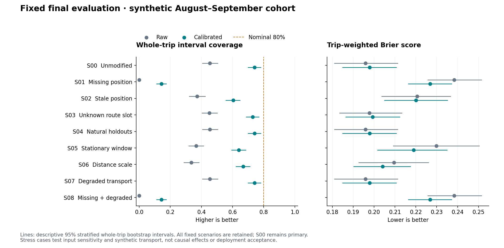

# Fixed August–September final evaluation

This is an engineering and method demonstration on fixed synthetic trajectories, not
customer telemetry or a fleet trial. G14 (July interval undercoverage/width), G15 (July
probability-calibration deterioration) and G16 (low July policy recall and selection
optimism) remain open. A final measurement does not itself resolve their causes or
establish acceptable costs, precision, recall or latency. `quality_accepted` and
`operational_approval` remain false.

S00 whole-trip coverage is 243/328 (74.1%), below the nominal 80%. The descriptive 95%
whole-trip bootstrap range is 69.97%–78.09%. Its 92.0% weighted snapshot coverage
measures something different. Interval expansion changes mean width from 62.85 to 95.69
minutes and interval score from 96.05 to 115.04 minutes (lower is better). Probability
Brier score changes from 0.195852 to 0.197842 and log loss from 0.576995 to 0.581029;
both point estimates increase after calibration.

Paired calibrated-minus-raw changes are Brier +0.001990 [-0.003051, 0.006628] and log
loss +0.004034 [-0.009236, 0.015918]; brackets are descriptive 95% trip-bootstrap
ranges. Both ranges include zero, so the small point-estimate deterioration is not
statistically established inferiority. The paired interval-score change is +1139.09
[980.55, 1299.06] seconds. These comparisons stay conditional on the fixed synthetic
sample and do not select a replacement pipeline.

The original unseen route, ROUTE-12, has whole-trip coverage of 0/33 (0.0%). The
seen-vehicle/unseen-route group covers 0/29 eligible trips, and the joint holdout covers
0/4. Available or native model output does not demonstrate successful generalization.
The four-trip joint group is sparse; no bootstrap interval is reported for it. A zero
observed rate or a degenerate [0, 0] resampling range for the larger route group
describes this sample, not proof that future-population coverage is exactly zero.

When all position inputs are removed in S01, whole-trip coverage is 47/328 (14.3%). This
shows substantial sensitivity to the declared missing-position perturbation; it does not
estimate a causal effect of a real outage on arrival time.

The original P05 R01 models, preprocessing, history pools and calibrators, P06 0.550000
rule, and P07 transport algorithm are unchanged. July development results were already
observed. The P08 implementation and conformance evidence were registered before final
target access, then all nine forecast/policy/transport ledgers were retained and hashed
before targets were joined. No final result selects a model, calibrator, threshold,
fallback or preferred stress scenario. S00 remains primary.

## Primary result and support

All 400 original test trips and 3,200 opportunities are retained in every scenario. The
original novelty groups contain 325 seen/seen, 37 unseen-vehicle/seen-route, 34
seen-vehicle/unseen-route and four joint-holdout trips. The four-trip group remains
visible; it cannot establish reliable generalization.

ETA scoring has 1,579 eligible snapshots from 328 trips before availability; 1,579
snapshots from 328 trips are scored. Binary scoring independently has 1,579 eligible
snapshots from 328 trips and scores 1,579 snapshots from 328 trips. The remaining 1,621
ETA and 1,621 binary opportunities keep explicit exclusion reasons.

| ETA output | Available snapshots | Scored snapshots / trips | MAE (min) | Whole-trip coverage | Weighted snapshot coverage | Width (min) | Interval score (min) |
| --- | --- | --- | --- | --- | --- | --- | --- |
| Historical ETA baseline | 2,142/3,200 | 1,569/328 | 21.23 | 196/328 (59.8%) | 74.2% | 69.38 | 122.75 |
| Raw pipeline | 3,200/3,200 | 1,579/328 | 17.54 | 149/328 (45.4%) | 79.4% | 62.85 | 96.05 |
| Calibrated pipeline | 3,200/3,200 | 1,579/328 | 17.54 | 243/328 (74.1%) | 92.0% | 95.69 | 115.04 |
| Stored projection | 3,200/3,200 | 1,579/328 | 17.54 | 243/328 (74.1%) | 92.0% | 95.70 | 115.05 |

Whole-trip coverage requires every eligible snapshot to have an interval and be covered;
an unavailable interval is a miss. Weighted snapshot coverage is a different quantity.
Snapshot errors and probability losses first average within each scored trip, then give
each scored trip equal weight. Calibrated endpoints are expanded bounds, not new
quantile estimates. Stored ETA bounds round outward; the median rounds half-even. Their
separate projection row is not a new calibration.

The historical baseline and pipeline have different marginal scoring support. On the
fixed common 1,569 snapshots from 328 trips, pipeline-minus-baseline median MAE is
-206.824 seconds. Use this paired comparison rather than subtracting the marginal means
in the table. Lost support is reported separately; the reference comparison cannot
promote a new final-test model.

| Probability output | Available snapshots | Scored snapshots / trips | Brier | Log loss | Fixed-bin ECE | ROC AUC | Average precision |
| --- | --- | --- | --- | --- | --- | --- | --- |
| Training prevalence | 3,200/3,200 | 1,579/328 | 0.2360 | 0.6647 | 0.0171 | 0.5717 | 0.4404 |
| Raw classifier | 3,200/3,200 | 1,579/328 | 0.1959 | 0.5770 | 0.0415 | 0.7505 | 0.6800 |
| Calibrated classifier | 3,200/3,200 | 1,579/328 | 0.1978 | 0.5810 | 0.0497 | 0.7480 | 0.6775 |
| Six-decimal projection | 3,200/3,200 | 1,579/328 | 0.1978 | 0.5810 | 0.0497 | 0.7480 | 0.6775 |

Proper scores use precise retained probabilities. The policy separately consumes the
six-decimal half-even projection. Ten fixed reliability bins,
native/fallback/unavailable support, fitted/unsupported calibration, single-class null
reasons and paired support are retained in [primary forecast
metrics](scenarios/S00_unmodified/forecast_metrics.json).

| Excluded target reason | ETA snapshots | Binary snapshots |
| --- | --- | --- |
| already_arrived_at_snapshot | 721 | 721 |
| latest_outcome_cancelled | 36 | 36 |
| latest_outcome_incomplete | 864 | 864 |

## Candidates and confirmed synthetic delivery

| Measure | Primary S00 result |
| --- | --- |
| Candidates / monitored trips | 63 / 400 |
| Actionable trips captured by a candidate | 29/137 (21.2%) |
| True / eligible first candidates | 29/42 (69.0%) |
| Unresolved / all first candidates | 5 / 47 |
| Transport attempts / retry attempts | 59 / 10 |
| Confirmed deliveries / delivered trips | 42 / 42 |
| Useful delivered trips / actionable positive trips | 26/137 (19.0%) |
| Useful / known-assessable first successes | 26/38 (68.4%) |
| Unresolved / all first successful deliveries | 4 / 42 |
| Post-arrival / insufficient-lead first successes | 0 / 0 |
| Unknown / queued transport attempts | 1 / 0 |
| Additional candidates / deliveries within an episode | 16 / 0 |
| Candidates / attempts / successful deliveries per 100 trips | 15.75 / 14.75 / 10.50 |

The primary run has 42 first successful deliveries, of which 38 are known-assessable and
4 remain unresolved. Conditional useful-first precision is 26/38 (68.4%);
all-first-success usefulness is bounded by 61.9%–71.4%. These are identification bounds,
not confidence intervals. Known post-arrival or insufficient-notice deliveries are
non-useful even when their binary modeling target is excluded. Unknown targets are never
relabeled on time. The count of attempts with unknown transport status is 1, separate
from the 4 unresolved first-delivery targets.

| Classification | All events | Global first events |
| --- | --- | --- |
| Confirmed true candidates | 43 | 29 |
| Known false candidates | 15 | 13 |
| Unresolved candidate targets | 5 | 5 |
| Retrospectively post-arrival candidates | 0 | 0 |
| Useful successful deliveries | 26 | 26 |
| Known false successful deliveries | 12 | 12 |
| Unresolved successful-delivery targets | 4 | 4 |
| Post-arrival successful deliveries | 0 | 0 |
| Insufficient-lead successful deliveries | 0 | 0 |

Actionable-positive support is label-defined and includes trips with unavailable
forecasts or blocked candidates. First candidates and first successful deliveries are
selected globally without targets and retain their own promise. Snapshot slices
attribute those existing identities; they do not choose a later, more favorable event.
The secondary first-effective lead is descriptive among captured trips only. Failed
attempts count as transport work, not delivered disturbances. Candidate/day capacity is
not receipt-day volume.

| Clock (seconds) | N / missing | Min | P10 | P25 | Median | P75 | P90 | Max |
| --- | --- | --- | --- | --- | --- | --- | --- | --- |
| Candidate to promise deadline | 63 / 0 | 1,807.72 | 3,497.41 | 4,786.86 | 7,451.20 | 11,441.20 | 14,651.76 | 15,239.76 |
| First success to promise deadline | 42 / 0 | 1,975.72 | 3,520.53 | 6,111.26 | 7,684.34 | 12,785.26 | 14,672.56 | 14,944.76 |
| First success to actual arrival (retrospective) | 38 / 4 | 8.80 | 5,862.31 | 8,266.54 | 9,901.80 | 12,719.63 | 14,558.57 | 17,221.19 |
| Candidate to first success | 42 / 0 | 5.00 | 8.30 | 17.50 | 38.50 | 55.00 | 107.60 | 137.00 |
| Successful attempt service latency | 42 / 0 | 5.00 | 8.30 | 17.25 | 36.00 | 46.75 | 55.00 | 60.00 |
| First useful delivery to promise (secondary) | 26 / 0 | 1,975.72 | 4,542.76 | 6,213.92 | 7,329.34 | 9,428.20 | 12,892.76 | 14,944.76 |

Retrospective arrival advance becomes assessable from later outcome evidence; it was not
information available to dispatch. Successful-attempt latency excludes earlier failed
attempts and retry waits, whereas candidate-to-success time includes them. All quantiles
use the fixed linear interpolation rule.

## All nine predeclared scenarios

The following forecast values use the calibrated pipeline. Every scenario keeps the
complete population and targets. S04 retains the unchanged full population and
forecasts, so its S00-equivalent totals are expected; its natural holdouts are reported
as separate slices, not another independent replication. S07 preserves the S00 forecasts
and candidate ledger and changes only transport. S08 preserves the S01 forecasts and
candidate ledger and applies that same degraded transport law. Shared exogenous hash
draws remain fixed; they are not resampled until success. Feature perturbations measure
input sensitivity, not causal changes to arrivals.

| Scenario | Whole-trip coverage | MAE (min) | Width (min) | Brier | Log loss |
| --- | --- | --- | --- | --- | --- |
| S00 Unmodified (primary) | 243/328 (74.1%) | 17.54 | 95.69 | 0.1978 | 0.5810 |
| S01 Missing position | 47/328 (14.3%) | 36.89 | 125.82 | 0.2268 | 0.6453 |
| S02 Stale position | 198/328 (60.4%) | 33.23 | 121.42 | 0.2201 | 0.6324 |
| S03 Unknown route slot | 239/328 (72.9%) | 17.92 | 95.07 | 0.1993 | 0.5841 |
| S04 Natural entity holdouts | 243/328 (74.1%) | 17.54 | 95.69 | 0.1978 | 0.5810 |
| S05 Stationary window | 210/328 (64.0%) | 21.32 | 109.10 | 0.2189 | 0.6400 |
| S06 Distance scaled 1.25 | 219/328 (66.8%) | 19.54 | 100.73 | 0.2041 | 0.5947 |
| S07 Degraded transport | 243/328 (74.1%) | 17.54 | 95.69 | 0.1978 | 0.5810 |
| S08 Missing + degraded | 47/328 (14.3%) | 36.89 | 125.82 | 0.2268 | 0.6453 |



| Scenario | Candidates | Attempts | Confirmed deliveries | Useful / actionable trips | Useful / assessable first successes | Unresolved / first successes | Unknown / queued attempts |
| --- | --- | --- | --- | --- | --- | --- | --- |
| S00 | 63 | 59 | 42 | 26/137 (19.0%) | 26/38 (68.4%) | 4/42 | 1/0 |
| S01 | 60 | 54 | 46 | 22/137 (16.1%) | 22/42 (52.4%) | 4/46 | 0/0 |
| S02 | 52 | 57 | 45 | 23/137 (16.8%) | 23/35 (65.7%) | 8/43 | 1/0 |
| S03 | 62 | 58 | 41 | 27/137 (19.7%) | 27/37 (73.0%) | 4/41 | 1/0 |
| S04 | 63 | 59 | 42 | 26/137 (19.0%) | 26/38 (68.4%) | 4/42 | 1/0 |
| S05 | 74 | 64 | 46 | 29/137 (21.2%) | 29/43 (67.4%) | 2/45 | 2/0 |
| S06 | 68 | 59 | 46 | 27/137 (19.7%) | 27/42 (64.3%) | 4/46 | 0/0 |
| S07 | 63 | 67 | 35 | 19/137 (13.9%) | 19/31 (61.3%) | 4/35 | 5/0 |
| S08 | 60 | 66 | 38 | 19/137 (13.9%) | 19/35 (54.3%) | 3/38 | 3/0 |

S07 has 35 first successful deliveries: 19 useful, 11 known false, 4 unresolved and 1
post-arrival. Its conditional useful-first precision is 19/31 (61.3%). The known
post-arrival case stays in the denominator even though it is excluded from binary model
scoring; it cannot be dropped to inflate precision.

Each support entry below counts opportunities out of 3,200. Unsupported calibration
preserves explicitly uncalibrated raw output; it is not silently presented as fitted
calibration.

| Scenario | ETA native / fallback / unavailable | ETA fitted / unsupported / unavailable | Probability native / fallback / unavailable | Probability fitted / unsupported / unavailable |
| --- | --- | --- | --- | --- |
| S00 | 3200 / 0 / 0 | 3200 / 0 / 0 | 3200 / 0 / 0 | 3200 / 0 / 0 |
| S01 | 3200 / 0 / 0 | 3200 / 0 / 0 | 3200 / 0 / 0 | 3200 / 0 / 0 |
| S02 | 3200 / 0 / 0 | 3200 / 0 / 0 | 3200 / 0 / 0 | 3200 / 0 / 0 |
| S03 | 3200 / 0 / 0 | 3200 / 0 / 0 | 3200 / 0 / 0 | 3200 / 0 / 0 |
| S04 | 3200 / 0 / 0 | 3200 / 0 / 0 | 3200 / 0 / 0 | 3200 / 0 / 0 |
| S05 | 3200 / 0 / 0 | 3200 / 0 / 0 | 3200 / 0 / 0 | 3200 / 0 / 0 |
| S06 | 3200 / 0 / 0 | 3200 / 0 / 0 | 3200 / 0 / 0 | 3200 / 0 / 0 |
| S07 | 3200 / 0 / 0 | 3200 / 0 / 0 | 3200 / 0 / 0 | 3200 / 0 / 0 |
| S08 | 3200 / 0 / 0 | 3200 / 0 / 0 | 3200 / 0 / 0 | 3200 / 0 / 0 |

All raw/calibrated/baseline/projected metrics, paired changes, complete subgroups and
event-time distributions remain in each scenario folder. No better-looking case replaces
S00.

## Original holdouts and uncertainty

| Original novelty group | All trips | ETA-eligible trips | ETA-scored trips | Whole-trip coverage | Brier | Useful / actionable trips |
| --- | --- | --- | --- | --- | --- | --- |
| Seen vehicle / seen route | 325 | 262 | 262 | 214/262 (81.7%) | 0.1982 | 20/103 (19.4%) |
| Unseen vehicle / seen route | 37 | 33 | 33 | 29/33 (87.9%) | 0.1957 | 2/15 (13.3%) |
| Seen vehicle / unseen route | 34 | 29 | 29 | 0/29 (0.0%) | 0.1947 | 4/17 (23.5%) |
| Unseen vehicle / unseen route | 4 | 4 | 4 | 0/4 (0.0%) | 0.2153 | 0/2 (0.0%) |

Forecast-metric uncertainty ranges use the fixed 2,000-replicate
tenant/novelty-stratified whole-trip bootstrap. The predictive ETA bounds themselves
come from the frozen calibration states. Each trip keeps its snapshots and paired
methods together. These are descriptive intervals conditional on this synthetic sample,
not future-fleet confidence guarantees or a complete treatment of route/vehicle
dependence. Intervals are null below 20 original scored trips or with an undefined
replicate denominator. Policy/delivery measures use exact counts and identification
bounds; they are not trip-binomial confidence estimates.

Tenant, route, August/September, original GPS validity, elapsed-time, deadline-advance,
source and calibration-support slices remain separate in the machine-readable reports.
The early/late duration view uses known elapsed time, not future trip duration.

## Formal outputs and clocks

Each scenario has 27 typed tables: eight canonical outputs, three reserved downstream
schemas and 16 auxiliary audit tables. These are separate stores, not a rebuilt M2
warehouse. The primary counts below are not summed across scenarios.

| Canonical table | Primary S00 rows |
| --- | --- |
| `eta_model_version` | 3 |
| `eta_evaluation_membership` | 3200 |
| `eta_prediction` | 3200 |
| `eta_alert_rule_version` | 1 |
| `eta_output_release` | 3200 |
| `eta_alert_episode` | 283 |
| `eta_alert` | 63 |
| `eta_notification_delivery` | 59 |
| `eta_adoption` | 0 |
| `eta_action` | 0 |
| `eta_action_followup` | 0 |

`received_or_opened_at` remains null. No message reached a user, and no recipient
opening, adoption, operator action or follow-up is simulated. Event clocks describe the
synthetic August–September scenario. Output-release and materialization clocks record
actual offline execution. Stable candidate/attempt identities across scenarios do not
assert that multiple real notifications occurred.

Whole-trip membership follows local Los Angeles departure dates, including snapshots
crossing midnight. Outcome versions must be known strictly before 2026-10-15T07:00:00Z;
receipt knowledge at that exact clock counts. Binary delay means independent
second-precision gate arrival strictly after the original snapshot promise, with zero
grace. ETA also accepts minute precision. Service start, completion and partial proof of
delivery are not arrival substitutes.

## Verification and reproduction

The first execution stopped before final target access because the historical-report
inventory included its own temporary P08 output directory. The execution guard was
repaired to exclude only reserved P08 output/attempt directories and to check this
before inference; 727 tests then passed and the implementation was registered again
before target access. The scientific configuration, models, inputs and metadata
inventory did not change. All 97 compared input/scenario artifacts sealed before target
access had identical hashes. That comparison was recorded after the first target access
and does not move the original freeze clocks. This was a pre-target execution repair,
not a post-target scoring correction. The [failure
record](../../reproducibility/p08/history/pre_target_attempt_01_failure.json), [repair
registration](../../reproducibility/p08/history/pre_target_revision.json), and
[97-artifact
comparison](../../reproducibility/p08/history/pre_target_artifact_comparison.json)
remain available with the original source snapshot.

The retained [unit suite](unittest_results.txt) passed 727 tests. The [independent
reference](independent_checks.json) made 10,349,858 comparisons with zero failures.
[Retained replay](retained_replay.json) found zero differences across nine scenarios,
including typed DB/JSONL/Parquet store checks. See [execution
receipt](run_receipt.json), [pre-target ledger receipt](pretarget_receipt.json),
[implementation registration](implementation_freeze.json) and the [frozen
specification](../../docs/p08_evaluation_protocol.md). These checks establish
reproducible implementation behavior, not quality acceptance, GitHub CI or execution on
the user's computer.

| Recorded event | Actual UTC timestamp |
| --- | --- |
| Implementation registered after conformance | 2026-11-14T06:03:02.545031+00:00 |
| All nine label-free ledgers retained | 2026-11-14T06:06:32.387594+00:00 |
| First final-outcome access started | 2026-11-14T06:06:33.118798+00:00 |
| Scoring and independent check completed | 2026-11-14T06:23:22.216952+00:00 |
| Completed result and retained replay verified | 2026-11-14T06:31:08.087915+00:00 |

Use the environment in the [repository quick
start](../../README.md#check-a-saved-forecast-run). Retained replay uses saved final
target evidence and does not reopen the raw outcome file. Run it from the frozen P08
commit or an isolated checkout containing its recorded source set. The verifier binds
the exact source inventory; later P09 source, script or test additions are intentionally
outside that registration and require a separately versioned workflow.

```bash
python -m ds_m01.final_replay --root . --report reports/p08
python scripts/check_final_evaluation.py --root . --report reports/p08 --output /tmp/p08_independent_checks.json
```

Choose a fresh independent-check output path. Expected results are `status: passed`,
zero differences/failures and nine scenarios. Source-assisted replay additionally
requires the exact frozen input root:

```bash
python -m ds_m01.final_replay --root . --report reports/p08 --input-root /path/to/frozen_input_root
```

Both modes occur after final target exposure. They reproduce the existing evaluation;
neither creates another untouched test. A future methodological change needs its own
version and evaluation design. A correction must preserve the first exposed attempt and
disclose that exposure; reference hashes must not be changed to hide a mismatch.

## What comes next?

P09 adds recipient adoption/override, actions, follow-up and the viewer. M4.2 is not
fully closed by transport simulation or P08 evaluation. G14/G15/G16 remain open; service
integration, measured operational acceptance and later deployment work remain separate.
The fixed final results are retained without refitting, reselection or model promotion.
